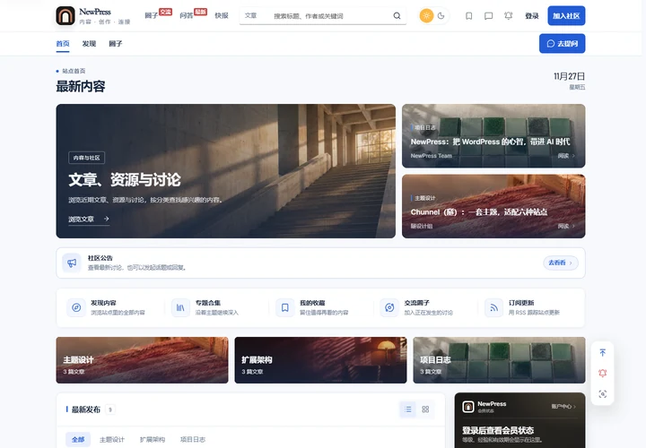
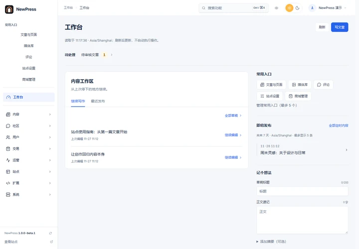
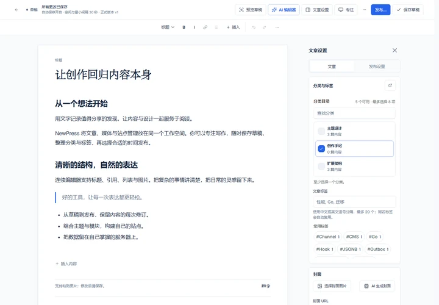
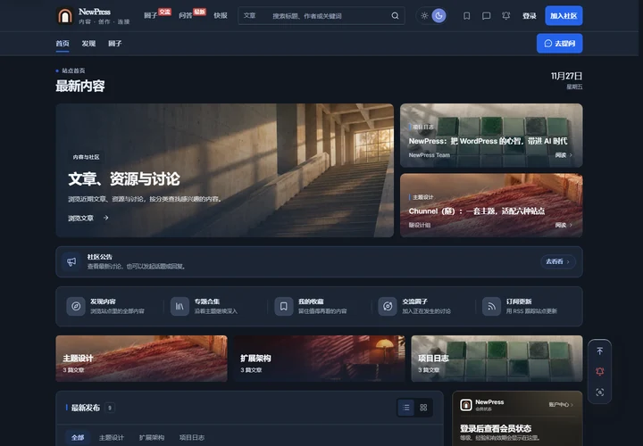
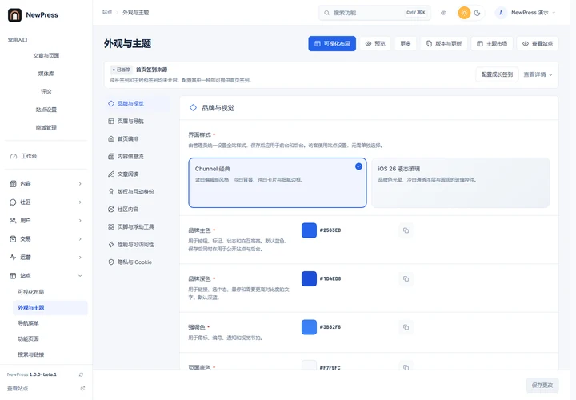
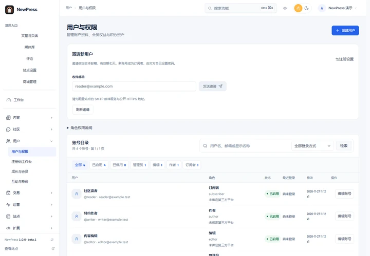
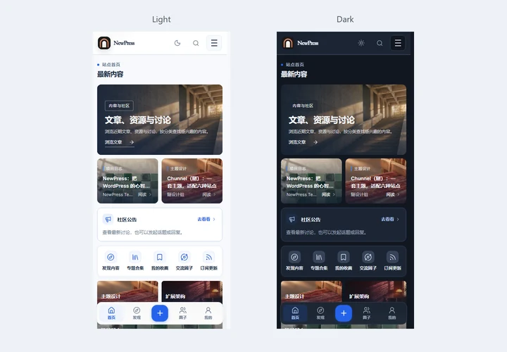

<p align="center">
  
</p>

<h1 align="center">NewPress</h1>

<p align="center">
  <a href="README.md">简体中文</a> &nbsp;·&nbsp;
  <a href="README.zh-TW.md">繁體中文</a> &nbsp;·&nbsp;
  <a href="README.en.md">English</a> &nbsp;·&nbsp;
  <a href="README.ja.md">日本語</a>
</p>

<p align="center">A self-hosted content management system built with Go</p>

<p align="center">
  <a href="internal/version/version.go"></a>
  <a href="go.mod"></a>
  <a href="#deployment"></a>
  <a href="LICENSE"></a>
</p>

<p align="center">
  <a href="#ui-preview">UI preview</a> &nbsp;·&nbsp;
  <a href="#deployment">Deployment</a> &nbsp;·&nbsp;
  <a href="#first-login">First login</a> &nbsp;·&nbsp;
  <a href="#configuration">Configuration</a> &nbsp;·&nbsp;
  <a href="#updates-and-maintenance">Updates and maintenance</a> &nbsp;·&nbsp;
  <a href="#backup-and-recovery">Backup and recovery</a> &nbsp;·&nbsp;
  <a href="#faq">FAQ</a>
</p>

---

NewPress provides posts, pages, a media library, and an administration dashboard for blogs, resource-sharing sites, communities, and business websites. Fresh installations using the standard Docker image or native installation wizard preinstall only Chunnel as the default theme; other themes are installed on demand. The source tree also includes development example themes. Content is stored in local files or PostgreSQL.

> [!NOTE]
> The current source version is `1.0.0-beta.2`; a stable release is not yet available. File storage supports a single writer process only. Login sessions are persisted and remain usable across restarts until they expire. See [session persistence and deployment boundaries](SESSION_PERSISTENCE.md).

| Feature | Includes |
| --- | --- |
| Content management | Posts and pages, categories and tags, revisions, autosave, comment moderation |
| Media and appearance | Media library, navigation, homepage layout, theme installation and switching |
| Accounts and permissions | User management, roles and permissions, registration settings |
| Content migration | Markdown files and WordPress WXR 1.2 import with previews |
| Extensions | Official theme and plugin catalogs, signature verification, installation, updates, and rollback |
| Optional modules | Circles, private messages, notifications, shop, points and virtual currency, AI-assisted editing; configure the required modules and services before use |

Maintainer: **ChunYang** · Public contact: [Chunnel@linux.do](mailto:Chunnel@linux.do)

Core repositories: [GitHub](https://github.com/chunyangnet/NewPress) · [Gitee mirror for servers in China](https://gitee.com/chunyangnet_0/newpress). Both publish the same source commits and version tags. Themes and plugins retain their separate Orangefen GitHub repositories and mirrors under the shared Gitee account; they do not move to the core project's GitHub account.

## UI preview

Click a thumbnail to view the full-size screenshot. These captures use an isolated `1.0.0-beta.1` demo environment with sample data and the Simplified Chinese interface. Appearance varies with theme settings and enabled modules.

| Homepage | Admin dashboard |
| --- | --- |
| [](assets/screenshots/home-desktop.webp) | [](assets/screenshots/admin-dashboard.webp) |

| Article view | Content editor |
| --- | --- |
| [](assets/screenshots/article-desktop.webp) | [](assets/screenshots/admin-editor.webp) |

<details>
<summary>More screenshots: dark mode, appearance settings, user management, and mobile</summary>

| Dark homepage | Appearance settings |
| --- | --- |
| [](assets/screenshots/home-dark.webp) | [](assets/screenshots/admin-appearance.webp) |

| User management | Mobile: light and dark |
| --- | --- |
| [](assets/screenshots/admin-users.webp) | [](assets/screenshots/mobile.webp) |

</details>

## Deployment

### One-command prebuilt installation

The installer defaults to `v1.0.0-beta.2`, selects the CPU architecture, and verifies a prebuilt deployment bundle. Native installations use the included executable; Docker installations import publisher-built images. Git, Go, Node.js, and Buildx are not required on the target. See [binary releases](BINARY_RELEASES.md).

The server needs Linux, Bash, curl, tar, and sha256sum. On Debian / Ubuntu: `sudo apt-get update && sudo apt-get install -y curl ca-certificates tar coreutils`. Run the installer as a regular user; service installation uses sudo when needed.

**GitHub:**

```bash
curl --proto '=https' --proto-redir '=https' -fL --connect-timeout 10 --max-time 60 -o newpress-install.sh https://raw.githubusercontent.com/chunyangnet/NewPress/v1.0.0-beta.2/install.sh && \
bash newpress-install.sh --source auto --dir ./newpress
```

**Gitee entry (installer from Gitee; release packages use measured GitHub proxies):**

```bash
curl --proto '=https' --proto-redir '=https' -fL --connect-timeout 10 --max-time 60 -o newpress-install.sh https://gitee.com/chunyangnet_0/newpress/raw/v1.0.0-beta.2/install.sh && \
bash newpress-install.sh --source auto --dir ./newpress
```

`--source auto` concurrently samples GitHub, gh-proxy.com, ghfast.top, and ghproxy.net from the installation server and prefers the fastest valid file transfer. Download or checksum failures try the next source. `--source github` downloads packages directly; `--ref` selects a release tag and `--commit` checks its source commit. Checksums come only from official GitHub / Gitee repositories. Missing system components use their own package repositories.

The destination must be a new directory. Deployment options follow `--`, for example `-- --mode native`. Keep the deployment directory to run its `scripts/deploy.sh` management commands.

### Linux installation wizard

Linux amd64 and arm64 are supported. The installer starts the wizard automatically. For a manually extracted bundle, run from the directory containing `deployment.json`, `compose.yaml`, and `themes/`:

```bash
sudo bash scripts/deploy.sh
```

Choose “安装 / 更新” (Install / update), select a deployment mode, and enter the bind address, port, and public site URL. Initial installation sets up the administrator account and displays the site URL and health-check results when finished.

| Mode | Components | Requirements |
| --- | --- | --- |
| Docker Compose | NewPress, PostgreSQL, NGINX | Local Docker Engine, Compose 2.20+ |
| Native service | NewPress binary, systemd; file storage by default | A running systemd; uses the included prebuilt executable |

The wizard uses Bash and Python 3.9+; the Bash entry point can bootstrap missing Python. Automatic Docker installation supports Debian / Ubuntu. Prepare Docker yourself on other distributions. Deployment uses the generated frontend assets included in the repository; Node.js is not required.

See [Configuration](#configuration) for domains and HTTPS. You do not need to copy `.env.example` before the first run; the wizard generates the environment file.

<details>
<summary>Manual Docker Compose: PowerShell 7.2+ example</summary>

For initializing an empty environment with Docker in Linux-container mode. This example builds the default `newpress:local` image and generates the administrator password hash inside a container; Go is not required on the host.

```powershell
Copy-Item .env.example .env
New-Item -ItemType Directory -Force .secrets | Out-Null

docker compose build migrate
if ($LASTEXITCODE -ne 0) { throw 'Image build failed' }

$databasePassword = [Convert]::ToHexString([Security.Cryptography.RandomNumberGenerator]::GetBytes(32)).ToLowerInvariant()
Set-Content -LiteralPath .secrets/postgres_password -Value $databasePassword -Encoding utf8 -NoNewline
Set-Content -LiteralPath .secrets/database_url -Value "postgres://newpress:$databasePassword@db:5432/newpress?sslmode=disable" -Encoding utf8 -NoNewline
Read-Host 'Administrator password (at least 12 characters)' -MaskInput |
    docker run --rm -i --network none newpress:local admin hash-password |
    Set-Content -LiteralPath .secrets/admin_password_hash -Encoding utf8 -NoNewline
if ($LASTEXITCODE -ne 0) { throw 'Administrator password hash generation failed' }
Remove-Variable databasePassword

docker compose config --quiet
if ($LASTEXITCODE -ne 0) { throw 'Compose configuration validation failed' }
docker compose up -d --no-build --wait
```

The default site URL is <http://localhost:8080>, with the dashboard at <http://localhost:8080/admin/>. Compose exposes only NGINX's HTTP port on the host; the application and database use an internal network. On a server, set `NEWPRESS_PUBLIC_URL` to the actual public URL and configure HTTPS.

Keep the generated `.env` and `.secrets/`. For existing sites, follow [Updates and maintenance](#updates-and-maintenance). Restrict secret files to operators and services that need access. Do not commit runtime data or credentials to the repository.

</details>

<details>
<summary>Run from local source: Go and PowerShell 7.2+ example</summary>

Requires Go 1.26.11; see the toolchain declaration in [go.mod](go.mod). Generated frontend assets are already included.

To preview the site and the read-only dashboard:

```sh
go run ./cmd/newpress serve
```

Open <http://localhost:8080>. To create an administrator and enable dashboard writes, stop the preview process first, then run:

```powershell
New-Item -ItemType Directory -Force .secrets | Out-Null
Read-Host 'Administrator password (at least 12 characters)' -MaskInput |
    go run ./cmd/newpress admin hash-password |
    Set-Content -LiteralPath .secrets/admin_password_hash -Encoding utf8 -NoNewline
if ($LASTEXITCODE -ne 0) { throw 'Administrator password hash generation failed' }

$env:NEWPRESS_ADMIN_USERNAME = 'admin'
$env:NEWPRESS_ADMIN_PASSWORD_HASH_FILE = (Resolve-Path .secrets/admin_password_hash).Path
go run ./cmd/newpress serve
```

The administrator is created only when the user database is empty. Later bootstrap configuration does not overwrite existing accounts. When running directly, pass configuration through the process environment; the application does not automatically read the project `.env` file.

The default is an empty site. With file storage, set `NEWPRESS_SEED_DEMO=true` before the content store is first created to load demo posts. Existing content stores, including initialized empty stores, do not receive demo posts. To start a separate demo site, point `NEWPRESS_DATA_DIR` to a new directory. The application service in the standard Compose configuration always disables demo content.

</details>

## First login

Use the site URL shown at the end of installation. The dashboard is at `/admin/` on the same site.

There is no default administrator password. The Linux wizard lets you choose a login name and password. Passwords must contain at least 12 characters and are hidden during entry. A custom password is stored only as a hash. If left blank, a random password is generated and saved in a restricted first-login file:

| Deployment | Default first-login file |
| --- | --- |
| Docker wizard | `.secrets/first-login.txt` |
| Native wizard | `/etc/newpress/first-login.txt` |

This plaintext file is not created for a custom password. Edit existing administrator profiles and passwords in the dashboard.

| Dashboard route | Common settings |
| --- | --- |
| `/admin/settings/` | Site name, language, time zone, registration, modules, and service configuration |
| `/admin/appearance/` | Active theme settings and homepage layout |
| `/admin/navigation/` | Navigation menus and links |
| `/admin/users/` | Administrator profiles, users, and permissions |
| `/admin/import/` | Import Markdown or WordPress WXR content; preview before confirming |

For sites deployed with the Linux wizard, use the account menu to look up the login name or reset a password. Resetting a password invalidates that account's existing login sessions.

```bash
sudo bash scripts/deploy.sh admin
```

## Configuration

See [.env.example](.env.example) for configuration options. The deployment environment controls listening addresses, database connections, and trusted proxies; manage the site name, appearance, and daily operations in the dashboard.

| Runtime | Configuration source |
| --- | --- |
| Docker Compose | `.env` and `.secrets/` in the project root |
| Native systemd | `/etc/newpress/newpress.env` and `/etc/newpress/secrets/` |
| Local source | Process environment variables; credentials can be read through the corresponding `*_FILE` variables |

Before initial installation, you may prepare a project-root `.env` file for the wizard. Site settings are initialized on first startup. Values later saved in the dashboard take precedence; redeployment does not overwrite existing settings.

<details>
<summary>Common environment variables and defaults</summary>

| Variable | Default | Purpose |
| --- | --- | --- |
| `NEWPRESS_PUBLIC_URL` | `http://localhost:8080` | The origin users actually visit; affects links, same-origin checks, and cookies |
| `NEWPRESS_HTTP_BIND` | `0.0.0.0` | Host bind address for Compose / the wizard |
| `NEWPRESS_HTTP_PORT` | `8080` | HTTP port for Compose / the wizard |
| `NEWPRESS_ADDR` | `:8080` | Bind address when running the Go service directly |
| `NEWPRESS_DATABASE_URL` / `NEWPRESS_DATABASE_URL_FILE` | Unset | Direct runs use file storage when unset; standard Compose mounts a PostgreSQL connection secret |
| `NEWPRESS_COMMUNITY_ENABLED` | `false` | Enables the server-side circles service; also enable the community module in the dashboard |

</details>

### Domains and HTTPS

The operator must configure certificates and external NGINX / Caddy. Set `NEWPRESS_PUBLIC_URL` to the actual public URL, such as `https://example.com`. Setting an HTTPS URL alone does not configure certificates.

With the Linux wizard and a reverse proxy on the same host, set the following in the environment file in use:

```dotenv
NEWPRESS_PUBLIC_URL=https://example.com
NEWPRESS_HTTP_BIND=127.0.0.1
NEWPRESS_HTTP_PORT=8080
NEWPRESS_PROXY_MODE=local
```

Point the external proxy to `http://127.0.0.1:8080`, preserve `Host`, and rebuild `X-Forwarded-For` and `X-Forwarded-Proto` from the actual connection. For a remote proxy, use `NEWPRESS_PROXY_MODE=remote` and set `NEWPRESS_EXTERNAL_PROXY_CIDRS` to its precise source networks.

If an existing native service explicitly sets `NEWPRESS_TRUSTED_PROXY_CIDRS`, update it when switching proxies too. For a local IPv4 proxy, use `127.0.0.1/32`.

`NEWPRESS_PROXY_MODE` is handled by the deployment scripts. The [NGINX template](deploy/nginx.conf) for manual Compose defaults to direct HTTP access. Adapt proxy-header handling for an external HTTPS reverse proxy; use `NEWPRESS_NGINX_CONFIG` to select a separate configuration. When running the service directly, set `NEWPRESS_TRUSTED_PROXY_CIDRS` to the actual trusted proxies.

Apply environment changes as described below. DNS, the external proxy, and firewall rules must match the listening address as well.

## Updates and maintenance

Back up first, read [CHANGELOG.md](CHANGELOG.md), and update your local source to the target version.

For sites deployed with the Linux wizard, run these commands from the original project directory:

| Operation | Command |
| --- | --- |
| Check the environment and download sources | `sudo bash scripts/deploy.sh check` |
| Apply source or configuration changes | `sudo bash scripts/deploy.sh deploy` |
| Show status | `sudo bash scripts/deploy.sh status` |
| Follow recent logs | `sudo bash scripts/deploy.sh logs --tail 100 --follow` |
| Restart the site | `sudo bash scripts/deploy.sh restart` |
| Stop the site | `sudo bash scripts/deploy.sh stop` |

In Docker mode, restart and stop affect only `app` and `proxy`; the database keeps running. `restart` does not recreate containers. Use `deploy` after changing `.env` or Compose files.

For manual Compose source or configuration updates:

```sh
docker compose build migrate
docker compose up -d --no-build --wait
```

The deployment scripts preserve saved base-image references. To upgrade those images, review and edit `NEWPRESS_GO_IMAGE`, `NEWPRESS_RUNTIME_IMAGE`, `NEWPRESS_POSTGRES_IMAGE`, and `NEWPRESS_PROXY_IMAGE` in the environment file. References must include a full SHA-256 digest.

Select additional Compose files in order with repeated `--compose-file` options. Explicit options replace the saved list, so include every additional file you want to retain. Omitting the option reuses the existing list. The base `compose.yaml` is added automatically; specifying only that file clears the overlay selection. For example, to enable mail configuration:

```bash
sudo bash scripts/deploy.sh deploy --compose-file deploy/compose.mail.yaml
```

Before using extras such as the [mail configuration](deploy/compose.mail.yaml), prepare their required service parameters and secrets.

### Core updates from the dashboard

Online installation requires managed mode started with `newpress run`, as used by standard Docker Compose and the native installation wizard. The local-source `serve` examples do not support online switching. To enable it, build the binary first and start it with `newpress run`.

The `/admin/updates/` dashboard uses both official public sources by default, without GitHub / Gitee access tokens:

- GitHub: the `releases` update channel tag of `chunyangnet/NewPress`;
- Gitee: the `releases` update channel tag of `chunyangnet_0/newpress`;
- Current Beta channel: `updates/beta.json`.

The official update public key is embedded in the application. A fresh installation does not need a manually configured public key or access token; see [official_ed25519.pub](internal/update/official_ed25519.pub). For a custom publisher, obtain its public key through a trusted channel and set `NEWPRESS_UPDATE_PUBLIC_KEY` to override the built-in key. Private sources require an explicitly configured publisher key. An invalid override produces an error instead of silently falling back to the official key. The application never imports a new public key automatically from the update repository it is verifying. If the release branch or signed manifest has not been published, the check fails explicitly; missing files do not mean “up to date.”

The server verifies both manifests in parallel and prefers the valid one with the higher signed sequence number. Conflicting contents with the same sequence stop the update. Packages switch only between sources verified to contain the same release. Each source is pinned to the checked commit, and package length and SHA-256 are verified. Existing private Gitee source configuration is retained; switch back to the official public sources in update-source settings. Public requests never carry private tokens.

Core package downloads also measure GitHub proxies and fall back on failure. Gitee requires login for large files, so anonymous package downloads use GitHub and its proxies. Manifests are fetched only from official repositories; signatures, sizes, and SHA-256 remain mandatory.

Read the release notes and confirm that backups can be restored before installing. Source-based updates still require redeployment as described above. Updates to the original supervisor binary, container base images, or deployment protocol also require source / image redeployment. Do not run the first-time installer over an existing directory.

<details>
<summary>PostgreSQL online updates: recovery receipt</summary>

Sites using PostgreSQL, including standard Docker Compose deployments, also need a JSON receipt matching the update, confirming a backup and a restore drill completed within the past 24 hours. Operators fill in the receipt from actual results; it neither performs nor replaces database recovery.

Receipt fields: `schema` is `1`; `site` exactly matches `NEWPRESS_PUBLIC_URL`; `from` and `to` are the current and target core versions. `captured_at` and `restore_verified_at` are the actual backup and restore-verification timestamps with time zones; verification must not precede the backup or be in the future. `database_snapshot` and `site_files_snapshot` identify traceable database and site-file backups. Do not put database credentials in the receipt.

For Docker, save the receipt at `.secrets/update-recovery/backup.json`, or under the corresponding custom `NEWPRESS_SECRETS_DIR`. Allow the container's service user to read it and only operators to write it, then enable the read-only mount:

```bash
sudo bash scripts/deploy.sh deploy --compose-file deploy/compose.update-recovery.yaml
```

If mail or other overlays are already enabled, repeat their `--compose-file` options in the command above to retain the complete list. This configuration needs no Gitee token. The older `deploy/compose.updates-secret.yaml` remains available for private sources. For native PostgreSQL deployments, set `NEWPRESS_UPDATE_BACKUP_RECEIPT_FILE` in the service environment to the absolute path of the restricted receipt file. Back up, verify, and update the receipt for each upgrade. If these conditions cannot be met, use an offline backup and source redeployment instead.

</details>

## Backup and recovery

Back up site content, media, and deployment configuration together. The locations below assume default deployment paths:

| Runtime | What to save |
| --- | --- |
| Local file storage | Data, media, theme and plugin directories, deployment configuration, and credentials |
| Standard Docker Compose | PostgreSQL backups, persistent volumes for data, themes, plugins, and updates, plus `.env` and `.secrets/` |
| Native systemd | `/var/lib/newpress/` and `/etc/newpress/`; back up the database separately when using PostgreSQL |

For custom directories, use the actual values of `NEWPRESS_DATA_DIR`, `NEWPRESS_THEMES_DIR`, and `NEWPRESS_PLUGINS_DIR`. See [compose.yaml](compose.yaml) for Docker volume definitions.

### File storage

The built-in backup commands support file storage only. Stop services using the same data, theme, and plugin directories first, then run in the original configuration environment. Example for a local source deployment:

```sh
go run ./cmd/newpress backup create ./site-backup.zip
go run ./cmd/newpress backup inspect ./site-backup.zip
go run ./cmd/newpress backup restore ./site-backup.zip --destination ./restored-site
```

The archive contains data, media, themes, and plugins from those three directories. Save the deployment environment, credentials outside those directories, and the application binary separately. Store the archive outside all three source directories; the restore destination must be new or empty.

The restore command validates the archive and prints the restored environment configuration. Set the data, theme, and plugin paths from the output's `environment` before starting the service. The original site is not overwritten.

### PostgreSQL

Use PostgreSQL tools such as `pg_dump` / `pg_restore` to back up and restore the database. Save media, themes, plugins, and deployment configuration for the same backup point. File-mode `backup create` cannot replace a database backup.

Keep backups outside the site's runtime directory and verify recovery in a separate directory or database.

## FAQ

<details>
<summary>What if downloading dependencies or images is slow?</summary>

The Linux wizard defaults to `auto`. It probes official sources and built-in mirrors in China, selects a source based on measurements from the current server, and tries alternatives on download failure. For manual Compose, see [.env.example](.env.example) for `NEWPRESS_GOPROXY`. The Go checksum database stays enabled.

</details>

<details>
<summary>Can I use WordPress themes and plugins directly?</summary>

No. NewPress has similar content models for posts, pages, and categories and can import Markdown and WordPress WXR 1.2 content. PHP themes, PHP plugins, and WordPress runtime APIs are not compatible.

</details>

<details>
<summary>Why can I view the local dashboard but not save?</summary>

When the user database is empty and no administrator bootstrap hash is configured, the dashboard allows read-only previews from loopback addresses only. Create an account using the local-source administrator example under [Deployment](#deployment), then sign in. Manage existing profiles and passwords in the dashboard.

</details>

<details>
<summary>Can I run multiple instances?</summary>

File storage supports a single writer process, with concurrent requests inside that process. Sessions are persisted in private files or PostgreSQL and survive restarts until expiry; PostgreSQL sessions support shared reads and revocation. The complete application still supports a single-instance deployment: local directory locks and filesystem-backed media and interaction state remain in place. See [session persistence and deployment boundaries](SESSION_PERSISTENCE.md).

</details>

<details>
<summary>Which interface languages are available?</summary>

Core shared strings and the Starter theme provide Simplified Chinese, Traditional Chinese, English, and Japanese. Chunnel, the dashboard, and some business interfaces still contain fixed Chinese text. Changing the site language does not translate posts or interfaces that do not use the language packs. See the [language-pack guide](internal/i18n/README.md) for coverage.

</details>

<details>
<summary>What do I need for AI-assisted editing?</summary>

Configure the relevant modules, model service URL, credentials, and model in the dashboard. Text and image features depend on the APIs supported by the connected service. Paid services charge according to their own pricing rules.

</details>

## Contributing and license

When reporting a problem, include the version, deployment mode, observed behavior, and sanitized logs. Report security issues privately as described in [SECURITY.md](SECURITY.md).

<details>
<summary>Source development and checks</summary>

Frontend changes require Node.js 22+. Run the following checks; see [CONTRIBUTING.md](CONTRIBUTING.md) for the complete contribution workflow:

```sh
npm ci --ignore-scripts
npm run build:frontend
npm run typecheck:frontend
npm run check:frontend
npm run test:frontend
go test ./...
go vet ./...
go build -trimpath -buildvcs=false ./cmd/newpress
```

Read the [theme development guide](themes/README.md), then start with [Starter](themes/starter/README.md), the [child-theme example](themes/starter-child/README.md), and the [presentation contract](internal/presentation/page.go). See [DESIGN.md](DESIGN.md) for design conventions and [RELEASING.md](RELEASING.md) for release preparation.

Public documentation is included with the source. `docs/` contains private maintainer materials and is excluded from public source archives and Docker build contexts.

</details>

Original code is licensed under [Apache-2.0](LICENSE). Third-party dependencies, fonts, and images retain their own licenses; see [THIRD_PARTY_NOTICES.md](THIRD_PARTY_NOTICES.md) and the declarations in asset directories. View the embedded license inventory with `go run ./cmd/newpress licenses`.

## Community support

Visit the Linux.do community to ask questions and share your experience. You can also contact the maintainer at [Chunnel@linux.do](mailto:Chunnel@linux.do).

<p align="center">
  <a href="https://linux.do/"></a>
</p>
