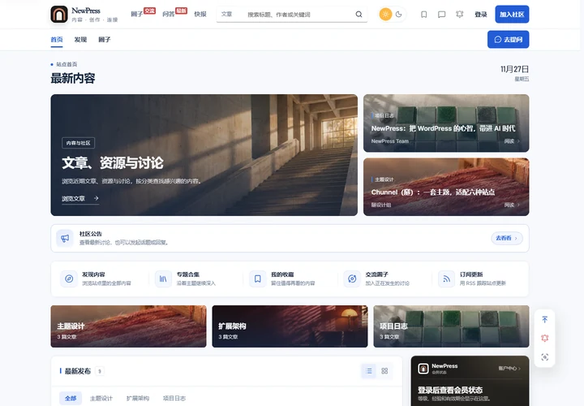
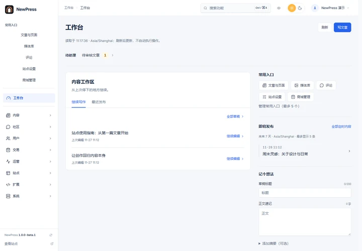
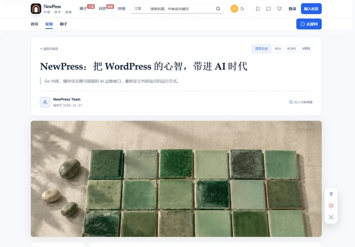
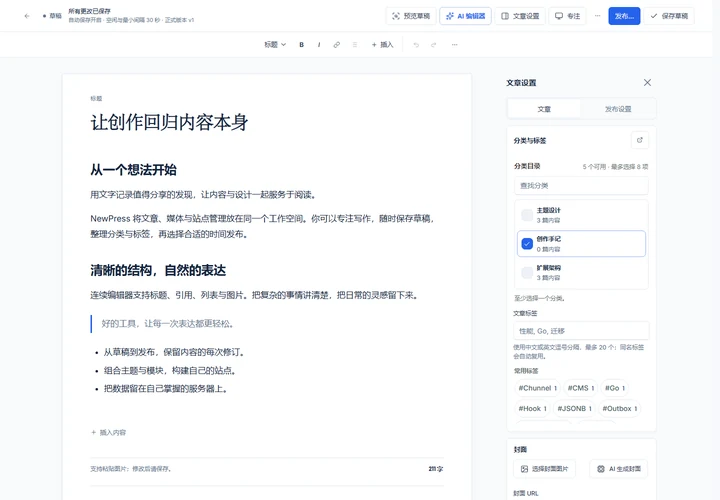
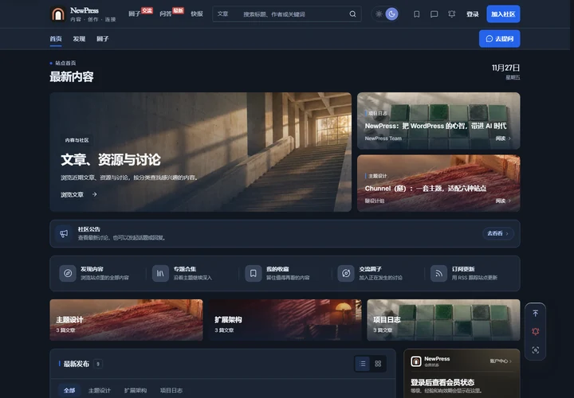
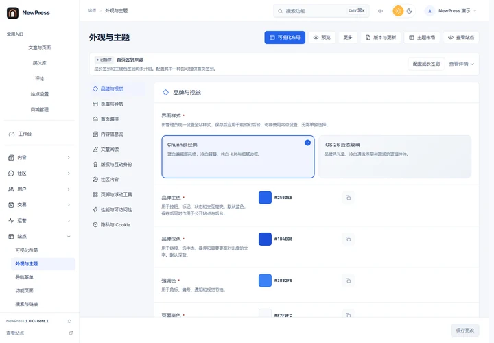
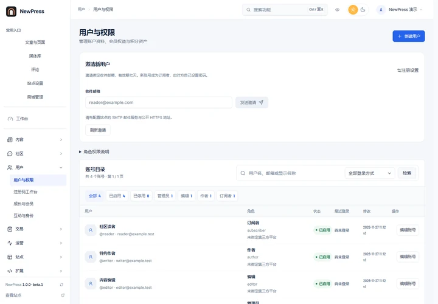
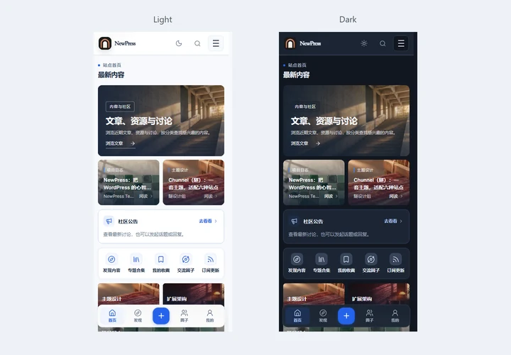

<p align="center">
  
</p>

<h1 align="center">NewPress</h1>

<p align="center">
  <a href="README.md">简体中文</a> &nbsp;·&nbsp;
  <a href="README.zh-TW.md">繁體中文</a> &nbsp;·&nbsp;
  <a href="README.en.md">English</a> &nbsp;·&nbsp;
  <a href="README.ja.md">日本語</a>
</p>

<p align="center">Go 製のセルフホスト型コンテンツ管理システム</p>

<p align="center">
  <a href="internal/version/version.go"></a>
  <a href="go.mod"></a>
  <a href="#デプロイ"></a>
  <a href="LICENSE"></a>
</p>

<p align="center">
  <a href="#ui-プレビュー">UI プレビュー</a> &nbsp;·&nbsp;
  <a href="#デプロイ">デプロイ</a> &nbsp;·&nbsp;
  <a href="#初回ログイン">初回ログイン</a> &nbsp;·&nbsp;
  <a href="#設定">設定</a> &nbsp;·&nbsp;
  <a href="#更新と保守">更新と保守</a> &nbsp;·&nbsp;
  <a href="#バックアップと復元">バックアップと復元</a> &nbsp;·&nbsp;
  <a href="#よくある質問">よくある質問</a>
</p>

---

NewPress は、投稿、固定ページ、メディアライブラリ、管理画面を備え、ブログ、リソース共有サイト、コミュニティ、企業サイトに利用できます。標準 Docker イメージとネイティブインストールウィザードによる新規インストールでは、標準テーマの Chunnel のみをプリインストールし、他のテーマは必要に応じてインストールします。ソースツリーには開発用のサンプルテーマも含まれています。コンテンツはローカルファイルまたは PostgreSQL に保存します。

> [!NOTE]
> 現在のソースコードのバージョンは `1.0.0-beta.2` です。安定版はまだリリースされていません。ファイルストレージへの書き込みは単一プロセスのみ対応しています。ログインセッションは永続化され、有効期限内であれば再起動後も利用できます。詳細は[セッションとデプロイの制約](SESSION_PERSISTENCE.md)を参照してください。

| 機能 | 内容 |
| --- | --- |
| コンテンツ管理 | 投稿と固定ページ、カテゴリーとタグ、リビジョン、自動保存、コメント承認 |
| メディアと外観 | メディアライブラリ、ナビゲーション設定、ホームのレイアウト、テーマのインストールと切り替え |
| アカウントと権限 | ユーザー管理、ロールと権限、登録設定 |
| コンテンツ移行 | Markdown ファイル、WordPress WXR 1.2 のインポートとプレビュー |
| 拡張機能管理 | 公式テーマ・プラグインカタログ、署名検証、インストール、更新、ロールバック |
| 任意のモジュール | サークル、ダイレクトメッセージ、通知、ショップ、ポイントと仮想通貨、AI 編集支援。利用前に対応するモジュールとサービスを設定してください |

メンテナー：**ChunYang** · 連絡先：[Chunnel@linux.do](mailto:Chunnel@linux.do)

コアのリポジトリ：[GitHub](https://github.com/chunyangnet/NewPress) · [中国国内向け Gitee ミラー](https://gitee.com/chunyangnet_0/newpress)。両方に同一のソースコミットとバージョンタグを公開します。テーマとプラグインは、独立した Orangefen の GitHub リポジトリと、共通の Gitee アカウント配下のミラーを引き続き使用し、コアの GitHub アカウントへは移行しません。

## UI プレビュー

サムネイルをクリックすると、元のサイズの画像を確認できます。スクリーンショットは `1.0.0-beta.1` の独立したデモ環境で撮影し、サンプルデータと簡体字中国語の UI を使用しています。実際の表示はテーマ設定や有効なモジュールによって異なります。

| ホーム | 管理ダッシュボード |
| --- | --- |
| [](assets/screenshots/home-desktop.webp) | [](assets/screenshots/admin-dashboard.webp) |

| 記事の閲覧 | コンテンツエディター |
| --- | --- |
| [](assets/screenshots/article-desktop.webp) | [](assets/screenshots/admin-editor.webp) |

<details>
<summary>その他の画面：ダークモード、外観設定、ユーザー管理、モバイル</summary>

| ダークモードのホーム | 外観設定 |
| --- | --- |
| [](assets/screenshots/home-dark.webp) | [](assets/screenshots/admin-appearance.webp) |

| ユーザー管理 | モバイル：ライトとダーク |
| --- | --- |
| [](assets/screenshots/admin-users.webp) | [](assets/screenshots/mobile.webp) |

</details>

## デプロイ

### ビルド済みパッケージのワンコマンドインストール

インストーラーは既定で `v1.0.0-beta.2` を使い、CPU に合った配布物をダウンロードして SHA-256 を確認します。ネイティブでは同梱バイナリ、Docker では事前ビルド済みイメージを使用します。導入先に Git、Go、Node.js、Buildx は不要です。[バイナリ配布](BINARY_RELEASES.md) を参照してください。

Linux、Bash、curl、tar、sha256sum が必要です。Debian / Ubuntu: `sudo apt-get update && sudo apt-get install -y curl ca-certificates tar coreutils`。通常ユーザーで実行し、サービスのインストール時に必要に応じて sudo を使います。

**GitHub：**

```bash
curl --proto '=https' --proto-redir '=https' -fL --connect-timeout 10 --max-time 60 -o newpress-install.sh https://raw.githubusercontent.com/chunyangnet/NewPress/v1.0.0-beta.2/install.sh && \
bash newpress-install.sh --source github --dir ./newpress
```

**Gitee（インストーラーとコアのソースの取得に GitHub を使用しません）：**

```bash
curl --proto '=https' --proto-redir '=https' -fL --connect-timeout 10 --max-time 60 -o newpress-install.sh https://gitee.com/chunyangnet_0/newpress/raw/v1.0.0-beta.2/install.sh && \
bash newpress-install.sh --source gitee --dir ./newpress
```

`--source auto` は GitHub、Gitee の順に試します。`--source gitee` は配布物とイメージ分割ファイルを Gitee からのみ取得します。`--ref` は公開済みタグ、`--commit` はソースコミットの追加確認に使えます。不足するシステムコンポーネントは各パッケージリポジトリから導入します。

対象は新しいディレクトリに限ります。導入オプションは `--` の後（例: `-- --mode native`）に指定します。導入ディレクトリを保存し、その `scripts/deploy.sh` で管理してください。

### Linux インストールウィザード

Linux `amd64` / `arm64` に対応しています。完全なソースを取得後、`go.mod`、`compose.yaml`、`themes/`、`plugins/` を含むプロジェクトルートで実行します。

Linux amd64 / arm64 に対応します。ワンコマンド入口はウィザードを自動起動します。手動で展開した場合は `deployment.json`、`compose.yaml`、`themes/` を含むディレクトリで実行してください：
sudo bash scripts/deploy.sh
```

メニューから「安装 / 更新」（インストール / 更新）を選択し、デプロイ方式、待ち受けアドレス、ポート、サイトの公開 URL を入力します。初回インストールでは管理者を設定し、完了後にアクセス先とヘルスチェックの結果を表示します。

| 方式 | 構成 | 必要な環境 |
| --- | --- | --- |
| Docker Compose | NewPress、PostgreSQL、NGINX | ローカルの Docker Engine、Compose 2.20+、Buildx |
| ネイティブサービス | NewPress バイナリ、systemd。標準はファイルストレージ | 稼働中の systemd。スクリプトが必要に応じて Go ツールチェーンを取得してビルド |

ウィザードは Bash と Python 3.9+ を使用し、Bash の起動スクリプトから不足する Python を導入できます。Docker の自動インストールは Debian / Ubuntu に対応しています。他のディストリビューションでは Docker を事前に用意してください。デプロイにはリポジトリ内の生成済みフロントエンド資産を使用するため、Node.js は不要です。

ドメインと HTTPS は[設定](#設定)を参照してください。初回実行前に `.env.example` をコピーする必要はなく、ウィザードが環境設定ファイルを生成します。

<details>
<summary>手動 Docker Compose：PowerShell 7.2+ の例</summary>

空の環境を初期化する場合の例です。Docker は Linux コンテナモードを使用します。標準の `newpress:local` イメージをビルドし、コンテナ内で管理者パスワードのハッシュを生成するため、ホストへの Go のインストールは不要です。

```powershell
Copy-Item .env.example .env
New-Item -ItemType Directory -Force .secrets | Out-Null

docker compose build migrate
if ($LASTEXITCODE -ne 0) { throw 'イメージのビルドに失敗しました' }

$databasePassword = [Convert]::ToHexString([Security.Cryptography.RandomNumberGenerator]::GetBytes(32)).ToLowerInvariant()
Set-Content -LiteralPath .secrets/postgres_password -Value $databasePassword -Encoding utf8 -NoNewline
Set-Content -LiteralPath .secrets/database_url -Value "postgres://newpress:$databasePassword@db:5432/newpress?sslmode=disable" -Encoding utf8 -NoNewline
Read-Host '管理者パスワード（12 文字以上）' -MaskInput |
    docker run --rm -i --network none newpress:local admin hash-password |
    Set-Content -LiteralPath .secrets/admin_password_hash -Encoding utf8 -NoNewline
if ($LASTEXITCODE -ne 0) { throw '管理者パスワードのハッシュ生成に失敗しました' }
Remove-Variable databasePassword

docker compose config --quiet
if ($LASTEXITCODE -ne 0) { throw 'Compose 設定の検証に失敗しました' }
docker compose up -d --no-build --wait
```

既定のサイト URL は <http://localhost:8080>、管理画面は <http://localhost:8080/admin/> です。Compose は NGINX の HTTP ポートのみをホストに公開し、アプリケーションとデータベースには内部ネットワークを使用します。サーバーへデプロイする場合は、`NEWPRESS_PUBLIC_URL` を実際の公開 URL に変更し、HTTPS を設定してください。

生成された `.env` と `.secrets/` は保存してください。既存サイトの更新は[更新と保守](#更新と保守)に従います。秘密情報を含むファイルには、運用担当者と読み取りが必要なサービスのみアクセスできるようにし、実行時データや認証情報をリポジトリへコミットしないでください。

</details>

<details>
<summary>ローカルソースからの実行：Go と PowerShell 7.2+ の例</summary>

Go 1.26.11 が必要です。ツールチェーンの宣言は [go.mod](go.mod) を参照してください。生成済みフロントエンド資産はリポジトリに含まれています。

サイトと読み取り専用の管理画面をプレビューするには：

```sh
go run ./cmd/newpress serve
```

<http://localhost:8080> を開きます。管理者を作成して管理画面で書き込みを行うには、まずプレビュープロセスを停止してから実行します。

```powershell
New-Item -ItemType Directory -Force .secrets | Out-Null
Read-Host '管理者パスワード（12 文字以上）' -MaskInput |
    go run ./cmd/newpress admin hash-password |
    Set-Content -LiteralPath .secrets/admin_password_hash -Encoding utf8 -NoNewline
if ($LASTEXITCODE -ne 0) { throw '管理者パスワードのハッシュ生成に失敗しました' }

$env:NEWPRESS_ADMIN_USERNAME = 'admin'
$env:NEWPRESS_ADMIN_PASSWORD_HASH_FILE = (Resolve-Path .secrets/admin_password_hash).Path
go run ./cmd/newpress serve
```

管理者はユーザーデータベースが空の場合にのみ作成されます。後から初期管理者設定を変更しても既存アカウントは上書きされません。直接実行する場合はプロセスの環境変数で設定を渡します。プロジェクトの `.env` は自動では読み込まれません。

標準では空のサイトを初期化します。ファイルストレージでデモ記事を読み込むには、コンテンツストアの初回作成前に `NEWPRESS_SEED_DEMO=true` を設定してください。初期化済みの空ストアを含め、既存ストアにはデモ記事を追加しません。独立したデモサイトを起動する場合は、`NEWPRESS_DATA_DIR` に新しいディレクトリを指定してください。標準 Compose のアプリケーションサービスでは、デモコンテンツは常に無効です。

</details>

## 初回ログイン

インストール終了時に表示されたサイト URL を使用します。管理画面は同じサイトの `/admin/` です。

既定の管理者パスワードはありません。Linux ウィザードではログイン名とパスワードを指定できます。パスワードは 12 文字以上で、入力中は表示されません。指定したパスワードはハッシュのみ保存します。空欄の場合はランダムなパスワードを生成し、アクセス制限付きの初回ログイン用ファイルへ保存します。

| デプロイ方式 | 初回ログイン用ファイルの既定の場所 |
| --- | --- |
| Docker ウィザード | `.secrets/first-login.txt` |
| ネイティブウィザード | `/etc/newpress/first-login.txt` |

パスワードを自分で指定した場合、この平文ファイルは生成されません。既存管理者のプロフィールとパスワードは管理画面で変更します。

| 管理画面のパス | 主な設定 |
| --- | --- |
| `/admin/settings/` | サイト名、言語、タイムゾーン、登録方法、モジュールとサービスの設定 |
| `/admin/appearance/` | 現在のテーマの設定とホームのレイアウト |
| `/admin/navigation/` | ナビゲーションメニューとリンク |
| `/admin/users/` | 管理者プロフィール、ユーザーと権限 |
| `/admin/import/` | Markdown または WordPress WXR コンテンツのインポート。確認前にプレビュー可能 |

Linux ウィザードでデプロイしたサイトでは、アカウントメニューからログイン名の確認やパスワードのリセットができます。リセットすると、そのアカウントの既存ログインセッションは無効になります。

```bash
sudo bash scripts/deploy.sh admin
```

## 設定

設定項目は [.env.example](.env.example) を参照してください。待ち受け、データベース接続、信頼するプロキシはデプロイ環境で設定します。サイト名、外観、日常の運用設定は管理画面で管理します。

| 実行方式 | 設定の読み込み元 |
| --- | --- |
| Docker Compose | プロジェクトルートの `.env` と `.secrets/` |
| ネイティブ systemd | `/etc/newpress/newpress.env` と `/etc/newpress/secrets/` |
| ローカルソース | 起動プロセスの環境変数。認証情報は対応する `*_FILE` 変数から読み込み可能 |

初回インストール前に、ウィザード用の `.env` をプロジェクトルートへ用意することもできます。サイト設定は初回起動時に初期化されます。その後は管理画面で保存した値が優先され、再デプロイしても既存の設定は上書きされません。

<details>
<summary>よく使う環境変数と既定値</summary>

| 設定項目 | 既定値 | 用途 |
| --- | --- | --- |
| `NEWPRESS_PUBLIC_URL` | `http://localhost:8080` | ユーザーが実際にアクセスするオリジン。リンク、同一オリジン検証、Cookie に影響 |
| `NEWPRESS_HTTP_BIND` | `0.0.0.0` | Compose / ウィザードのホスト待ち受けアドレス |
| `NEWPRESS_HTTP_PORT` | `8080` | Compose / ウィザードの HTTP ポート |
| `NEWPRESS_ADDR` | `:8080` | Go サービスを直接実行する場合の待ち受けアドレス |
| `NEWPRESS_DATABASE_URL` / `NEWPRESS_DATABASE_URL_FILE` | 未設定 | 直接実行で未設定の場合はファイルストレージ。標準 Compose は PostgreSQL 接続用シークレットをマウント |
| `NEWPRESS_COMMUNITY_ENABLED` | `false` | サーバー側のサークルサービスを有効化。管理画面でコミュニティモジュールの有効化も必要 |

</details>

### ドメインと HTTPS

証明書と外部の NGINX / Caddy は運用者が設定します。`NEWPRESS_PUBLIC_URL` を `https://example.com` などの実際のアクセス URL に設定してください。HTTPS の URL を指定するだけでは証明書は設定されません。

Linux ウィザードを使用し、同じホストの外部リバースプロキシを経由する場合は、使用中の環境設定ファイルに次を設定します。

```dotenv
NEWPRESS_PUBLIC_URL=https://example.com
NEWPRESS_HTTP_BIND=127.0.0.1
NEWPRESS_HTTP_PORT=8080
NEWPRESS_PROXY_MODE=local
```

外部プロキシの転送先を `http://127.0.0.1:8080` にし、`Host` を保持して、実際の接続から `X-Forwarded-For` と `X-Forwarded-Proto` を再構成します。別ホストのプロキシでは `NEWPRESS_PROXY_MODE=remote` を使用し、`NEWPRESS_EXTERNAL_PROXY_CIDRS` に正確な送信元ネットワークを指定します。

既存のネイティブサービスで `NEWPRESS_TRUSTED_PROXY_CIDRS` を明示している場合は、プロキシ変更時にこちらも変更してください。ローカル IPv4 プロキシの場合は `127.0.0.1/32` です。

`NEWPRESS_PROXY_MODE` はデプロイスクリプトが処理します。手動 Compose 用の [NGINX テンプレート](deploy/nginx.conf)は、標準では直接の HTTP 接続向けです。外部 HTTPS リバースプロキシを使用する場合は、プロキシヘッダーの処理を調整してください。`NEWPRESS_NGINX_CONFIG` で別の設定を指定できます。サービスを直接実行する場合は、`NEWPRESS_TRUSTED_PROXY_CIDRS` で実際に信頼するプロキシを指定します。

環境設定ファイルの変更は次節の手順で反映します。DNS、外部プロキシ、ファイアウォールのルールも待ち受け設定に合わせてください。

## 更新と保守

更新前にバックアップを作成し、[CHANGELOG.md](CHANGELOG.md) を読んでから、ローカルソースを対象バージョンへ更新します。

Linux ウィザードでデプロイしたサイトでは、元のプロジェクトディレクトリで実行します。

| 操作 | コマンド |
| --- | --- |
| 環境とダウンロード元の確認 | `sudo bash scripts/deploy.sh check` |
| ソースや設定の変更を反映 | `sudo bash scripts/deploy.sh deploy` |
| 稼働状態の表示 | `sudo bash scripts/deploy.sh status` |
| 最近のログを追跡 | `sudo bash scripts/deploy.sh logs --tail 100 --follow` |
| サイトの再起動 | `sudo bash scripts/deploy.sh restart` |
| サイトの停止 | `sudo bash scripts/deploy.sh stop` |

Docker モードの再起動と停止は `app` と `proxy` のみを操作し、データベースは動作を継続します。`restart` はコンテナを再作成しません。`.env` や Compose ファイルを変更した場合は `deploy` を使用します。

手動 Compose でソースや設定を更新する場合：

```sh
docker compose build migrate
docker compose up -d --no-build --wait
```

デプロイスクリプトは保存済みのベースイメージ参照を保持します。イメージを更新する場合は、環境設定ファイルの `NEWPRESS_GO_IMAGE`、`NEWPRESS_RUNTIME_IMAGE`、`NEWPRESS_POSTGRES_IMAGE`、`NEWPRESS_PROXY_IMAGE` を確認して変更してください。参照には完全な SHA-256 digest が必要です。

追加の Compose ファイルは `--compose-file` を繰り返して順番に指定できます。明示的に指定すると保存済みの一覧を置き換えるため、保持する追加ファイルをすべて指定してください。省略時のみ既存の一覧を再利用します。基本の `compose.yaml` は自動で追加され、このファイルのみ指定すると追加ファイルの選択を解除します。メール設定を有効にする例：

```bash
sudo bash scripts/deploy.sh deploy --compose-file deploy/compose.mail.yaml
```

[メール設定](deploy/compose.mail.yaml)などの追加ファイルを使用する前に、そのファイルが必要とするサービス設定とシークレットを用意してください。

### 管理画面からのコア更新

オンラインインストールには `newpress run` で起動するプロセス監視モードが必要です。標準 Docker Compose とネイティブインストールウィザードはこの方式を使用します。ローカルソースの例で使う `serve` はオンライン切り替えに対応しません。利用する場合はバイナリをビルドしてから `newpress run` で起動してください。

管理画面の `/admin/updates/` は、標準で 2 つの公式公開ソースを使用します。GitHub / Gitee のアクセストークンは不要です。

- GitHub：`chunyangnet/NewPress` の `releases` ブランチ。
- Gitee：`chunyangnet_0/newpress` の `releases` ブランチ。
- 現在のベータ版チャンネル：`updates/beta.json`。

公式更新の公開鍵はプログラムに組み込まれているため、初回インストールで公開鍵やアクセストークンを設定する必要はありません。公開鍵ファイルは [official_ed25519.pub](internal/update/official_ed25519.pub) を参照してください。独自の配信者を使用する場合は、信頼できる経路でその公開鍵を取得し、`NEWPRESS_UPDATE_PUBLIC_KEY` で組み込み鍵を上書きします。非公開ソースでは配信者の公開鍵を明示的に設定する必要があります。上書き値が無効な場合はエラーとなり、公式鍵へ自動的に戻ることはありません。検証対象の更新リポジトリから新しい公開鍵を自動的に取り込むこともありません。配信ブランチや署名付きマニフェストが未公開なら、確認処理は明示的に失敗し、ファイルの欠落を「最新版」とは扱いません。

サーバーは両方のマニフェストを並列検証し、署名済みシーケンス番号が大きい有効なマニフェストを優先します。同じ番号で内容が異なる場合は更新を停止します。パッケージの取得先は、同一リリースであることを検証できたソース間でのみ切り替えます。各ソースを確認時のコミットに固定し、パッケージの長さと SHA-256 を再検証します。既存の非公開 Gitee ソース設定は保持され、更新ソース設定から公式公開ソースに戻せます。公開リクエストに非公開トークンは付加しません。

インストール前にリリースノートを読み、バックアップから復元できることを確認してください。ソースからの更新は前述の手順で再デプロイします。初期導入したプロセス監視プログラム、コンテナのベースイメージ、デプロイプロトコルの更新も、ソース / イメージの再デプロイで行います。初回インストーラーで既存ディレクトリを上書きしないでください。

<details>
<summary>PostgreSQL のオンライン更新：復元検証レシートの設定</summary>

標準の Docker Compose を含む PostgreSQL 利用サイトでは、オンラインインストール前に、今回の更新に対応し、過去 24 時間以内にバックアップと復元テストを完了したことを示す JSON レシートも必要です。運用者が実際の結果に基づいて記入します。レシート自体がデータベースの復元を実行したり、代わりになったりするものではありません。

レシートのフィールド：`schema` は `1`、`site` はサイトの `NEWPRESS_PUBLIC_URL` と完全一致、`from` と `to` は現在と更新先のコアバージョンです。`captured_at` と `restore_verified_at` は、実際のバックアップと復元検証のタイムゾーン付き日時で、検証時刻はバックアップより前、または現在時刻より後であってはいけません。`database_snapshot` と `site_files_snapshot` には、追跡可能なデータベースとサイトファイルのバックアップ識別子を指定します。データベースの認証情報をレシートへ記入しないでください。

Docker では `.secrets/update-recovery/backup.json` に保存します。`NEWPRESS_SECRETS_DIR` を変更している場合は、その配下の対応する場所を使用します。コンテナのサービスユーザーに読み取りを許可し、書き込みは運用者に限定してから、読み取り専用マウントを有効にします。

```bash
sudo bash scripts/deploy.sh deploy --compose-file deploy/compose.update-recovery.yaml
```

メールなどの追加設定が有効な場合は、上のコマンドにも対応する `--compose-file` を繰り返し指定し、一覧全体を保持してください。この設定に Gitee トークンは不要です。従来の `deploy/compose.updates-secret.yaml` は非公開ソース用に残しています。ネイティブ PostgreSQL 構成では、サービス環境の `NEWPRESS_UPDATE_BACKUP_RECEIPT_FILE` に、アクセス制限付きレシートの絶対パスを設定します。更新のたびにバックアップ、復元検証、レシート更新を行ってください。条件を満たせない場合は、サービスを停止してバックアップし、ソースから再デプロイします。

</details>

## バックアップと復元

サイトのコンテンツ、メディア、デプロイ設定をまとめて保存します。以下は既定のデプロイパスです。

| 実行方式 | 保存するもの |
| --- | --- |
| ローカルファイルストレージ | データ、メディア、テーマとプラグインのディレクトリ、デプロイ環境、認証情報 |
| 標準 Docker Compose | PostgreSQL のバックアップ、データ・テーマ・プラグイン・更新の永続ボリューム、`.env`、`.secrets/` |
| ネイティブ systemd | `/var/lib/newpress/` と `/etc/newpress/`。PostgreSQL 使用時はデータベースも別途バックアップ |

カスタムディレクトリでは、`NEWPRESS_DATA_DIR`、`NEWPRESS_THEMES_DIR`、`NEWPRESS_PLUGINS_DIR` の実際の値を使用してください。Docker の永続ボリューム定義は [compose.yaml](compose.yaml) を参照してください。

### ファイルストレージ

組み込みのバックアップコマンドはファイルストレージ専用です。同じデータ、テーマ、プラグインディレクトリを使用するサービスを停止してから、元の設定環境で実行してください。ローカルソースで実行する例：

```sh
go run ./cmd/newpress backup create ./site-backup.zip
go run ./cmd/newpress backup inspect ./site-backup.zip
go run ./cmd/newpress backup restore ./site-backup.zip --destination ./restored-site
```

アーカイブには、3 つのディレクトリ内のデータ、メディア、テーマ、プラグインが含まれます。デプロイ環境、ディレクトリ外の認証情報、アプリケーションのバイナリは別途保存してください。アーカイブは 3 つのソースディレクトリの外に作成し、復元先には新規または空のディレクトリを指定します。

復元コマンドはアーカイブを検証し、復元後の環境設定を出力します。出力の `environment` に従ってデータ、テーマ、プラグインのパスを設定してからサービスを起動してください。元のサイトは上書きされません。

### PostgreSQL

`pg_dump` / `pg_restore` などの PostgreSQL ツールでデータベースをバックアップ・復元し、同じバックアップ時点のメディア、テーマ、プラグイン、デプロイ設定も保存してください。ファイルモードの `backup create` はデータベースバックアップの代わりにはなりません。

バックアップはサイトの実行ディレクトリの外に保存し、別のディレクトリまたはデータベースで復元を検証してください。

## よくある質問

<details>
<summary>依存関係やイメージのダウンロードが遅い場合は？</summary>

Linux ウィザードの標準設定は `auto` です。公式ソースと組み込みの中国国内向けソースを検出し、現在のサーバーからの測定結果に基づいて選択します。ダウンロードに失敗すると他の利用可能なソースを試します。手動 Compose では [.env.example](.env.example) を参考に `NEWPRESS_GOPROXY` を設定できます。Go のチェックサムデータベースは有効なままです。

</details>

<details>
<summary>WordPress のテーマやプラグインをそのまま使えますか？</summary>

使えません。投稿、固定ページ、カテゴリーなどの似たコンテンツモデルがあり、Markdown と WordPress WXR 1.2 のコンテンツを移行できますが、PHP テーマ、PHP プラグイン、WordPress のランタイム API には互換性がありません。

</details>

<details>
<summary>ローカルの管理画面で表示はできても保存できないのはなぜですか？</summary>

ユーザーデータベースが空で、初期管理者のパスワードハッシュも設定していない場合、管理画面はループバックアドレスからの読み取り専用プレビューのみ許可します。[デプロイ](#デプロイ)にあるローカルソース実行の管理者作成例に従い、アカウントを作成してログインしてください。既存アカウントのプロフィールとパスワードは管理画面で変更します。

</details>

<details>
<summary>複数のインスタンスを実行できますか？</summary>

ファイルモードへの書き込みは単一プロセスのみ対応し、その内部で並行リクエストを処理します。セッションは非公開ファイルまたは PostgreSQL に永続化され、有効期限内であれば再起動後も利用できます。PostgreSQL のセッションは共有参照・失効に対応しますが、アプリ全体の対応範囲は引き続き単一インスタンスです。ローカルディレクトリのロックやメディア・記事操作のファイル状態には制約が残ります。[詳細](SESSION_PERSISTENCE.md)を確認してください。

</details>

<details>
<summary>どの表示言語に対応していますか？</summary>

コアの共通文字列と Starter テーマは、簡体字中国語、繁体字中国語、英語、日本語に対応しています。Chunnel、管理画面、一部の業務画面には固定の中国語表記が残っています。サイトの言語を切り替えても、投稿や言語パックを利用していない画面は自動翻訳されません。対応範囲は[言語パックの説明](internal/i18n/README.md)を参照してください。

</details>

<details>
<summary>AI 編集支援には何が必要ですか？</summary>

管理画面で、対応するモジュール、モデルサービスの URL、認証情報、モデルを設定します。テキスト・画像機能は接続先サービスが対応する API によって異なります。有料サービスの利用料金は、サービス提供者の規則に従います。

</details>

## 貢献とライセンス

問題を報告する際は、バージョン、デプロイ方式、実際の動作、機密情報を除いたログを添えてください。セキュリティ上の問題は [SECURITY.md](SECURITY.md) に従い、非公開で報告してください。

<details>
<summary>ソース開発とチェック</summary>

フロントエンドの変更には Node.js 22+ が必要です。以下のチェックを実行してください。貢献の詳しい手順は [CONTRIBUTING.md](CONTRIBUTING.md) を参照してください。

```sh
npm ci --ignore-scripts
npm run build:frontend
npm run typecheck:frontend
npm run check:frontend
npm run test:frontend
go test ./...
go vet ./...
go build -trimpath -buildvcs=false ./cmd/newpress
```

[テーマ開発ガイド](themes/README.md)を読み、[Starter](themes/starter/README.md)、[子テーマの例](themes/starter-child/README.md)、[表示契約](internal/presentation/page.go)から始められます。設計規約は [DESIGN.md](DESIGN.md)、リリース準備は [RELEASING.md](RELEASING.md) を参照してください。

公開ドキュメントはソースに含まれています。`docs/` はメンテナーのローカル資料であり、公開ソースアーカイブや Docker ビルドコンテキストには含まれません。

</details>

独自コードのライセンスは [Apache-2.0](LICENSE) です。サードパーティーの依存関係、フォント、画像には、それぞれのライセンスが適用されます。[THIRD_PARTY_NOTICES.md](THIRD_PARTY_NOTICES.md) と各リソースディレクトリの表記を参照してください。組み込みのライセンス一覧は `go run ./cmd/newpress licenses` で表示できます。

## コミュニティサポート

Linux.do コミュニティで質問や活用方法を共有できます。メンテナーへの連絡は [Chunnel@linux.do](mailto:Chunnel@linux.do) までお願いします。

<p align="center">
  <a href="https://linux.do/"></a>
</p>
