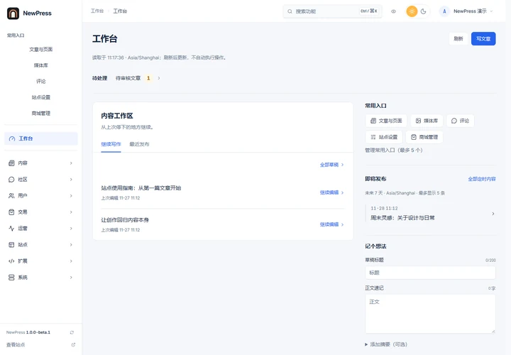
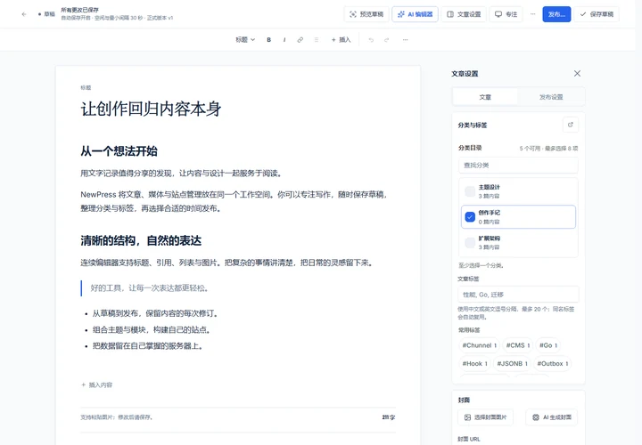
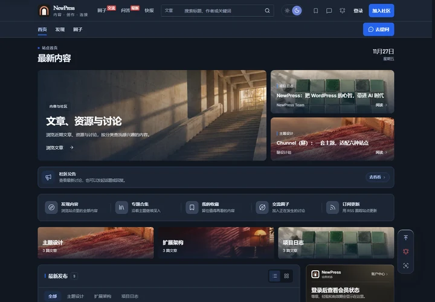
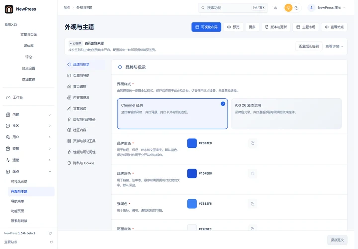
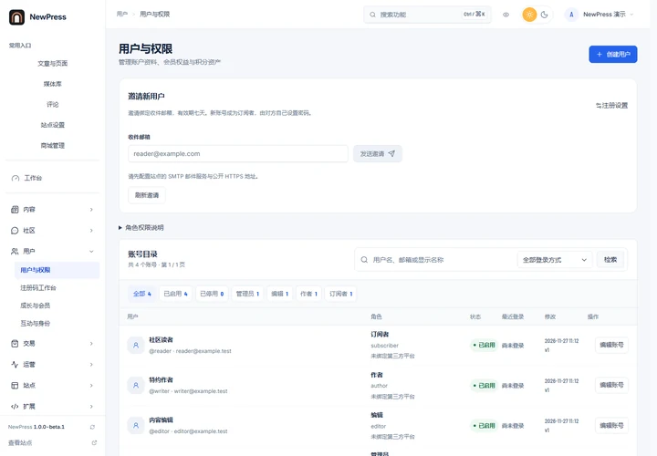
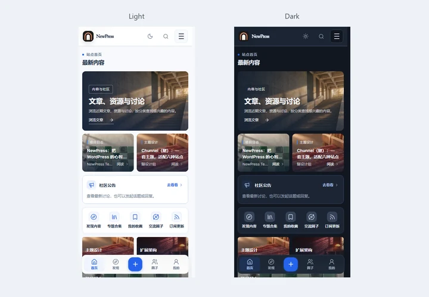

<p align="center">
  
</p>

<h1 align="center">NewPress</h1>

<p align="center">
  <a href="README.md">简体中文</a> &nbsp;·&nbsp;
  <a href="README.zh-TW.md">繁體中文</a> &nbsp;·&nbsp;
  <a href="README.en.md">English</a> &nbsp;·&nbsp;
  <a href="README.ja.md">日本語</a>
</p>

<p align="center">使用 Go 构建的自托管内容管理系统</p>

<p align="center">
  <a href="internal/version/version.go"></a>
  <a href="go.mod"></a>
  <a href="#部署"></a>
  <a href="LICENSE"></a>
</p>

<p align="center">
  <a href="#界面预览">界面预览</a> &nbsp;·&nbsp;
  <a href="#部署">部署</a> &nbsp;·&nbsp;
  <a href="#首次登录">首次登录</a> &nbsp;·&nbsp;
  <a href="#配置">配置</a> &nbsp;·&nbsp;
  <a href="#更新与维护">更新与维护</a> &nbsp;·&nbsp;
  <a href="#备份与恢复">备份与恢复</a> &nbsp;·&nbsp;
  <a href="#常见问题">常见问题</a>
</p>

---

NewPress 提供文章、页面、媒体库和管理后台，可用于博客、资源分享、社区及企业站点。新安装仅预装并默认使用 Chunnel 主题，其他主题按需安装；内容可保存在本地文件或 PostgreSQL 中。

> [!NOTE]
> 当前源码版本为 `1.0.0-beta.1`，尚未发布稳定版。文件存储仅支持单进程写入；登录会话已持久化，有效期内重启可继续使用。会话与多实例边界见[说明](SESSION_PERSISTENCE.md)。

| 功能 | 内容 |
| --- | --- |
| 内容管理 | 文章与页面、分类与标签、修订、自动保存、评论审核 |
| 媒体与外观 | 媒体库、导航设置、首页布局、主题安装与切换 |
| 账号与权限 | 用户管理、角色与权限、注册设置 |
| 内容迁入 | Markdown 文件、WordPress WXR 1.2 导入与预览 |
| 扩展管理 | 官方主题与插件目录、签名校验、安装、更新与回退 |
| 按需模块 | 圈子、私信、通知、商城、积分与虚拟币、AI 辅助编辑；使用前配置相应模块与服务 |

维护者：**ChunYang** · 公开联系：[Chunnel@linux.do](mailto:Chunnel@linux.do)

主程序：[GitHub 主仓库](https://github.com/chunyangnet/NewPress) · [Gitee 国内镜像](https://gitee.com/chunyangnet_0/newpress)。两边发布相同源码提交与版本标签。主题、插件继续使用各自独立的 Orangefen GitHub 仓库及统一 Gitee 账号下的镜像，不随主程序账号迁移。

## 界面预览

点击缩略图可查看原尺寸截图。截图来自 `1.0.0-beta.1` 的隔离演示环境，使用演示数据与简体中文界面；实际外观会随主题配置和启用模块变化。

| 首页 | 后台工作台 |
| --- | --- |
| [](assets/screenshots/home-desktop.webp) | [](assets/screenshots/admin-dashboard.webp) |

| 文章阅读 | 内容编辑器 |
| --- | --- |
| [](assets/screenshots/article-desktop.webp) | [](assets/screenshots/admin-editor.webp) |

<details>
<summary>更多截图：深色模式、外观设置、用户管理和手机端</summary>

| 深色首页 | 外观设置 |
| --- | --- |
| [](assets/screenshots/home-dark.webp) | [](assets/screenshots/admin-appearance.webp) |

| 用户管理 | 手机端：浅色与深色 |
| --- | --- |
| [](assets/screenshots/admin-users.webp) | [](assets/screenshots/mobile.webp) |

</details>

## 部署

### 双源源码安装入口

以下命令供仓库公开并且两边均发布 `v1.0.0-beta.1` 标签后使用。首次公开前，请上传项目到服务器，使用下一节的本地源码安装向导；仓库或标签尚不可访问时，安装器会明确报错。

服务器需要 Linux、Bash、Git 和 curl。Debian / Ubuntu 可先执行 `sudo apt-get update && sudo apt-get install -y git curl ca-certificates`。以普通用户下载并运行入口，向导在安装系统服务时按需使用 sudo。

**GitHub 入口：**

```bash
curl --proto '=https' --proto-redir '=https' -fL --connect-timeout 10 --max-time 60 -o newpress-install.sh https://raw.githubusercontent.com/chunyangnet/NewPress/v1.0.0-beta.1/install.sh && \
bash newpress-install.sh --source github --dir ./newpress
```

**Gitee 国内入口（获取安装器和主程序源码均不依赖 GitHub）：**

```bash
curl --proto '=https' --proto-redir '=https' -fL --connect-timeout 10 --max-time 60 -o newpress-install.sh https://gitee.com/chunyangnet_0/newpress/raw/v1.0.0-beta.1/install.sh && \
bash newpress-install.sh --source gitee --dir ./newpress
```

已取得安装器时，可用 `--source auto` 按 GitHub、Gitee 顺序失败切换；`--ref` 指定其他已发布标签，`--commit` 可额外核对发布说明中的完整提交 SHA。自动切换不按服务器地域猜测。`--source` 控制主程序仓库，后续 Go / Docker 依赖仍由部署向导独立检测、校验和选源。

安装器只写入**不存在的新目录**，不会覆盖已有源码、配置或站点数据。部署参数放在 `--` 后，例如 `bash newpress-install.sh --source gitee --dir ./newpress -- --mode native`。安装后保留该源码目录，后续管理命令均从其 `scripts/deploy.sh` 执行。

### Linux 安装向导

支持 Linux `amd64` / `arm64`。获取完整源码后，在包含 `go.mod`、`compose.yaml`、`themes/` 和 `plugins/` 的项目根目录运行：

```bash
sudo bash scripts/deploy.sh
```

在菜单中选择“安装 / 更新”，按提示选择部署方式，填写监听地址、端口和站点访问地址。首次安装会设置管理员，完成后显示访问地址及健康检查结果。

| 方式 | 运行组成 | 环境 |
| --- | --- | --- |
| Docker Compose | NewPress、PostgreSQL、NGINX | 本机 Docker Engine、Compose 2.20+、Buildx |
| 原生服务 | NewPress 二进制、systemd；默认使用文件存储 | 已运行的 systemd；脚本按需获取 Go 工具链并构建 |

向导使用 Bash 和 Python 3.9+，Bash 入口可引导安装缺少的 Python。Docker 的自动安装支持 Debian / Ubuntu；其他发行版需先准备 Docker 环境。部署使用仓库中已生成的前端资源，无需安装 Node.js。

域名与 HTTPS 按[配置](#配置)一节设置。首次运行无需先复制 `.env.example`，向导会生成环境文件。

<details>
<summary>手动 Docker Compose：PowerShell 7.2+ 示例</summary>

适用于首次初始化空环境，使用 Docker 的 Linux 容器模式。示例按默认镜像名 `newpress:local` 构建，通过容器生成管理员密码哈希，宿主机无需安装 Go。

```powershell
Copy-Item .env.example .env
New-Item -ItemType Directory -Force .secrets | Out-Null

docker compose build migrate
if ($LASTEXITCODE -ne 0) { throw '镜像构建失败' }

$databasePassword = [Convert]::ToHexString([Security.Cryptography.RandomNumberGenerator]::GetBytes(32)).ToLowerInvariant()
Set-Content -LiteralPath .secrets/postgres_password -Value $databasePassword -Encoding utf8 -NoNewline
Set-Content -LiteralPath .secrets/database_url -Value "postgres://newpress:$databasePassword@db:5432/newpress?sslmode=disable" -Encoding utf8 -NoNewline
Read-Host '管理员密码（至少 12 个字符）' -MaskInput |
    docker run --rm -i --network none newpress:local admin hash-password |
    Set-Content -LiteralPath .secrets/admin_password_hash -Encoding utf8 -NoNewline
if ($LASTEXITCODE -ne 0) { throw '管理员密码哈希生成失败' }
Remove-Variable databasePassword

docker compose config --quiet
if ($LASTEXITCODE -ne 0) { throw 'Compose 配置检查失败' }
docker compose up -d --no-build --wait
```

默认访问 <http://localhost:8080>，后台为 <http://localhost:8080/admin/>。Compose 仅向宿主公开 NGINX 的 HTTP 端口，应用与数据库使用内部网络。部署到服务器时，将 `NEWPRESS_PUBLIC_URL` 改为实际访问地址，并配置 HTTPS。

保留生成的 `.env` 和 `.secrets/`；已有站点的更新按[更新与维护](#更新与维护)执行。密钥文件应仅对运维账号和需要读取它们的服务开放，运行数据与凭据不应提交到仓库。

</details>

<details>
<summary>本地源码运行：Go 与 PowerShell 7.2+ 示例</summary>

需要 Go 1.26.11，工具链声明见 [go.mod](go.mod)。仓库已包含生成的前端资源。

仅查看站点和后台只读预览：

```sh
go run ./cmd/newpress serve
```

访问 <http://localhost:8080>。若要创建管理员并使用可写后台，先停止预览进程，再运行：

```powershell
New-Item -ItemType Directory -Force .secrets | Out-Null
Read-Host '管理员密码（至少 12 个字符）' -MaskInput |
    go run ./cmd/newpress admin hash-password |
    Set-Content -LiteralPath .secrets/admin_password_hash -Encoding utf8 -NoNewline
if ($LASTEXITCODE -ne 0) { throw '管理员密码哈希生成失败' }

$env:NEWPRESS_ADMIN_USERNAME = 'admin'
$env:NEWPRESS_ADMIN_PASSWORD_HASH_FILE = (Resolve-Path .secrets/admin_password_hash).Path
go run ./cmd/newpress serve
```

管理员仅在空用户库中创建，后续引导配置不会覆盖已有账号。直接运行时，通过进程环境传入配置；程序不会自动读取项目 `.env`。

默认初始化空站点。源码运行时可设置 `NEWPRESS_SEED_DEMO=true` 加载演示内容，已有内容会保留；标准 Compose 的应用服务固定关闭演示内容。

</details>

## 首次登录

使用安装结束时显示的站点地址，后台入口为同一站点的 `/admin/`。

没有默认管理员密码。Linux 向导支持自设登录名与密码，密码至少 12 个字符，输入内容隐藏。自设密码只保存哈希；留空时生成随机密码，并保存到受限的首次登录文件：

| 部署方式 | 首次登录文件的默认位置 |
| --- | --- |
| Docker 向导 | `.secrets/first-login.txt` |
| 原生向导 | `/etc/newpress/first-login.txt` |

自设密码时不生成该明文文件。已有管理员的资料和密码在后台修改。

| 后台入口 | 常用设置 |
| --- | --- |
| `/admin/settings/` | 站点名称、语言、时区、注册方式、模块与服务配置 |
| `/admin/appearance/` | 当前主题设置与首页布局 |
| `/admin/navigation/` | 导航菜单与链接 |
| `/admin/users/` | 管理员资料、用户与权限 |
| `/admin/import/` | 导入 Markdown 或 WordPress WXR 内容，先预览再确认 |

Linux 向导部署的站点可通过账号菜单查询登录名或重置密码。重置后，该账号原有登录会话失效。

```bash
sudo bash scripts/deploy.sh admin
```

## 配置

配置项见 [.env.example](.env.example)。部署环境控制监听、数据库连接和可信代理；站点名称、外观与日常运营设置在后台管理。

| 运行方式 | 配置来源 |
| --- | --- |
| Docker Compose | 项目根目录 `.env` 和 `.secrets/` |
| 原生 systemd | `/etc/newpress/newpress.env` 和 `/etc/newpress/secrets/` |
| 本地源码 | 启动进程的环境变量，凭据可通过对应的 `*_FILE` 变量读取 |

首次安装前，可在项目根目录准备 `.env` 供向导读取。站点设置在首次启动时初始化；以后后台保存的值优先，重新部署不会覆盖已有设置。

<details>
<summary>常用环境变量与默认值</summary>

| 配置项 | 默认值 | 用途 |
| --- | --- | --- |
| `NEWPRESS_PUBLIC_URL` | `http://localhost:8080` | 用户实际访问的站点 origin，影响链接、同源验证与 Cookie |
| `NEWPRESS_HTTP_BIND` | `0.0.0.0` | Compose / 向导的宿主监听地址 |
| `NEWPRESS_HTTP_PORT` | `8080` | Compose / 向导的 HTTP 端口 |
| `NEWPRESS_ADDR` | `:8080` | 直接运行 Go 服务时的监听地址 |
| `NEWPRESS_DATABASE_URL` / `NEWPRESS_DATABASE_URL_FILE` | 未设置 | 直接运行时，未设置则使用文件存储；标准 Compose 已挂载 PostgreSQL 连接密钥 |
| `NEWPRESS_COMMUNITY_ENABLED` | `false` | 开启服务器圈子服务，还需在后台开启社区模块 |

</details>

### 域名与 HTTPS

证书和外部 NGINX / Caddy 由部署者配置。将 `NEWPRESS_PUBLIC_URL` 填为实际访问地址，例如 `https://example.com`；仅填写 HTTPS 地址不会完成证书配置。

使用 Linux 向导、本机外部反向代理时，在所用环境文件中设置：

```dotenv
NEWPRESS_PUBLIC_URL=https://example.com
NEWPRESS_HTTP_BIND=127.0.0.1
NEWPRESS_HTTP_PORT=8080
NEWPRESS_PROXY_MODE=local
```

外部代理指向 `http://127.0.0.1:8080`，保留 `Host`，按实际连接重建 `X-Forwarded-For` 和 `X-Forwarded-Proto`。远程代理使用 `NEWPRESS_PROXY_MODE=remote`，并填写 `NEWPRESS_EXTERNAL_PROXY_CIDRS` 的精确来源网段。

已有原生服务若显式设置了 `NEWPRESS_TRUSTED_PROXY_CIDRS`，切换代理时也要同步修改；本机 IPv4 代理为 `127.0.0.1/32`。

`NEWPRESS_PROXY_MODE` 由部署脚本处理。手动 Compose 使用的 [NGINX 模板](deploy/nginx.conf) 默认面向 HTTP 直连；外部 HTTPS 反代需自行适配代理头处理，可用 `NEWPRESS_NGINX_CONFIG` 指定独立配置。直接运行服务时，用 `NEWPRESS_TRUSTED_PROXY_CIDRS` 设置实际可信代理。

修改环境文件后按下一节应用配置；域名解析、外部代理和防火墙规则也需与监听地址一致。

## 更新与维护

更新前先完成备份，阅读 [CHANGELOG.md](CHANGELOG.md)，再将本地源码更新到目标版本。

Linux 向导部署的站点，在原项目目录执行：

| 操作 | 命令 |
| --- | --- |
| 检查环境与下载源 | `sudo bash scripts/deploy.sh check` |
| 应用源码或配置变更 | `sudo bash scripts/deploy.sh deploy` |
| 查看运行状态 | `sudo bash scripts/deploy.sh status` |
| 跟随最近日志 | `sudo bash scripts/deploy.sh logs --tail 100 --follow` |
| 重启站点 | `sudo bash scripts/deploy.sh restart` |
| 停止站点 | `sudo bash scripts/deploy.sh stop` |

Docker 模式的重启、停止只操作 `app` 和 `proxy`，数据库保持运行。`restart` 不重新创建容器，修改 `.env` 或 Compose 文件后使用 `deploy`。

手动 Compose 的源码或配置更新：

```sh
docker compose build migrate
docker compose up -d --no-build --wait
```

部署脚本保留已保存的基础镜像引用。需要升级这些镜像时，核对并修改环境文件中的 `NEWPRESS_GO_IMAGE`、`NEWPRESS_RUNTIME_IMAGE`、`NEWPRESS_POSTGRES_IMAGE` 和 `NEWPRESS_PROXY_IMAGE`；引用须包含完整 SHA-256 digest。

附加 Compose 文件可通过重复的 `--compose-file` 选择，后续部署复用已保存的列表：

```bash
sudo bash scripts/deploy.sh deploy --compose-file deploy/compose.mail.yaml
```

使用 [邮件配置](deploy/compose.mail.yaml) 等附加文件前，先准备文件要求的服务参数与 secret。

### 后台核心更新

后台 `/admin/updates/` 默认使用官方公开双源，无需 GitHub / Gitee 访问令牌：

- GitHub：`chunyangnet/NewPress` 的 `releases` 分支；
- Gitee：`chunyangnet_0/newpress` 的 `releases` 分支；
- 当前测试版通道：`updates/beta.json`。

官方更新公钥随程序内置，首次安装无需填写公钥或访问令牌，公开公钥文件见 [official_ed25519.pub](internal/update/official_ed25519.pub)。需要自定义发布者时，可通过受信渠道取得其公钥并设置 `NEWPRESS_UPDATE_PUBLIC_KEY`，覆盖内置值；私有源必须显式配置其发布者公钥。无效的覆盖值会报错，不会静默退回官方公钥。程序不会从待验证的更新仓库自动导入新公钥。发布分支或签名清单尚未上传时，检查会明确失败，不会把缺失文件当成“已是最新版本”。

服务端并行核验两边清单，优先采用有效的较高签名序号；同一序号内容冲突时停止更新。更新包只在已经核验为同一发布的源之间切换，每个源固定到检查到的提交，并复核包长度与 SHA-256。已有 Gitee 私有源配置继续保留，可在更新源设置中切回官方公开双源；公开请求不携带私有令牌。

安装前阅读发布说明并确认可恢复的备份。源码更新仍按前述步骤重新部署；初始托管程序、容器基础镜像或部署协议升级也通过源码 / 镜像重新部署完成。不要用首次安装器覆盖已有目录。

<details>
<summary>PostgreSQL 在线升级：恢复回执配置</summary>

使用 PostgreSQL 的站点（包括默认 Docker Compose 部署），在线安装前还需提供与本次升级匹配、24 小时内完成备份和恢复演练的 JSON 回执。回执由运维根据实际结果填写，不会自动执行或代替数据库恢复。

回执字段：`schema` 为 `1`；`site` 与站点 `NEWPRESS_PUBLIC_URL` 完全一致；`from`、`to` 分别为当前和目标核心版本；`captured_at`、`restore_verified_at` 为带时区的实际备份及恢复验证时间，验证时间不得早于备份或晚于当前时间；`database_snapshot`、`site_files_snapshot` 为可追溯的数据库及站点文件备份标识。不得在回执中填写数据库凭据。

Docker 在 `.secrets/update-recovery/backup.json` 保存回执（自定义 `NEWPRESS_SECRETS_DIR` 时使用对应目录），确保容器服务用户可读、只有运维可写，然后启用只读挂载：

```bash
sudo bash scripts/deploy.sh deploy --compose-file deploy/compose.update-recovery.yaml
```

此配置无需 Gitee 令牌。旧的 `deploy/compose.updates-secret.yaml` 仍供私有源使用。原生 PostgreSQL 部署则在服务环境中将 `NEWPRESS_UPDATE_BACKUP_RECEIPT_FILE` 指向受限回执文件的绝对路径。每次升级重新备份、验证并更新回执；不满足条件时改用停机备份与源码重新部署流程。

</details>


## 备份与恢复

备份应同时保存站点内容、媒体和部署配置。以下位置按默认部署路径列出：

| 运行方式 | 需要保存的内容 |
| --- | --- |
| 本地文件存储 | 数据、媒体、主题与插件目录，以及部署环境与凭据 |
| 标准 Docker Compose | PostgreSQL 备份，数据、主题、插件与更新持久卷，以及 `.env`、`.secrets/` |
| 原生 systemd | `/var/lib/newpress/` 和 `/etc/newpress/`；连接 PostgreSQL 时另备份数据库 |

自定义目录以 `NEWPRESS_DATA_DIR`、`NEWPRESS_THEMES_DIR`、`NEWPRESS_PLUGINS_DIR` 的实际值为准。Docker 持久卷定义见 [compose.yaml](compose.yaml)。

### 文件存储

内置备份命令仅支持文件存储。先停止使用相同数据、主题与插件目录的服务，再在原来的配置环境中执行。以下为本地源码运行示例：

```sh
go run ./cmd/newpress backup create ./site-backup.zip
go run ./cmd/newpress backup inspect ./site-backup.zip
go run ./cmd/newpress backup restore ./site-backup.zip --destination ./restored-site
```

归档包含三个目录中的数据、媒体、主题与插件；部署环境、目录外的凭据和应用二进制需另行保存。归档必须放在这三个源目录之外，恢复目标必须是新目录或空目录。

恢复命令会检查归档并输出恢复后的环境配置。按输出中的 `environment` 设置数据、主题与插件路径后再启动服务；原站点不会被覆盖。

### PostgreSQL

使用 `pg_dump` / `pg_restore` 等 PostgreSQL 工具备份和恢复数据库，并在同一备份时间点保存媒体、主题、插件及部署配置。文件模式的 `backup create` 不能替代数据库备份。

将备份保存在站点运行目录之外，并在独立目录或独立数据库验证恢复。

## 常见问题

<details>
<summary>服务器下载依赖或镜像较慢怎么办？</summary>

Linux 向导默认使用 `auto` 策略，检测官方源和内置国内源，按当前服务器的采样结果选源，下载失败后尝试其他可用源。手动 Compose 可参考 [.env.example](.env.example) 设置 `NEWPRESS_GOPROXY`；Go 校验数据库保持启用。

</details>

<details>
<summary>能直接使用 WordPress 的主题和插件吗？</summary>

不能。NewPress 支持文章、页面、分类等类似内容模型，可迁入 Markdown 和 WordPress WXR 1.2 内容；PHP 主题、PHP 插件和 WordPress 运行时接口不兼容。

</details>

<details>
<summary>为什么本地后台只能查看，无法保存？</summary>

空用户库且未配置管理员引导哈希时，后台只允许回环地址只读预览。按[本地源码运行](#部署)中的管理员示例创建账号后登录；已有账号的资料和密码在后台修改。

</details>

<details>
<summary>能运行多个实例吗？</summary>

文件模式仅支持单进程写入，单个进程可处理并发请求。登录会话随存储模式写入私有文件或 PostgreSQL，有效期内重启可继续使用；PostgreSQL 会话支持共享读取和撤销。完整应用仍按单实例部署支持，本地目录锁及媒体、文章互动等状态的限制继续保留。详见[会话持久化与部署边界](SESSION_PERSISTENCE.md)。

</details>

<details>
<summary>有哪些界面语言？</summary>

核心通用词条和 Starter 主题提供简体中文、繁体中文、英文、日文。Chunnel、后台和部分业务界面仍有固定中文文案，切换站点语言不会自动翻译文章或未接入语言包的界面。接入范围见[语言包说明](internal/i18n/README.md)。

</details>

<details>
<summary>使用 AI 辅助编辑需要什么？</summary>

在后台配置相应模块、模型服务地址、凭据和模型。文本与图片功能取决于所接入服务支持的接口；使用收费服务时，调用费用按服务方规则计算。

</details>

## 贡献与许可证

问题复现时附上版本、部署方式、实际行为和已脱敏的日志。安全问题按 [SECURITY.md](SECURITY.md) 私下报告。

<details>
<summary>源码开发与检查</summary>

修改前端需要 Node.js 22+。运行以下检查，完整贡献流程见 [CONTRIBUTING.md](CONTRIBUTING.md)：

```sh
npm ci --ignore-scripts
npm run build:frontend
npm run typecheck:frontend
npm run check:frontend
npm run test:frontend
go test ./...
go vet ./...
go build -trimpath -buildvcs=false ./cmd/newpress
```

主题开发规范见 [公开指南](themes/README.md)，示例从 [Starter](themes/starter/README.md)、[子主题示例](themes/starter-child/README.md)和[展示契约](internal/presentation/page.go)开始。设计约定见 [DESIGN.md](DESIGN.md)，发布准备见 [RELEASING.md](RELEASING.md)。

公开说明随源码提供。`docs/` 是维护者本地资料，不随公开源码归档和 Docker 构建上下文分发。

</details>

原创代码采用 [Apache-2.0](LICENSE)。第三方依赖、字体和图片保留各自许可，详见 [THIRD_PARTY_NOTICES.md](THIRD_PARTY_NOTICES.md) 及资源目录声明。内置许可清单可通过 `go run ./cmd/newpress licenses` 查看。

## 社区支持

欢迎在 Linux.do 社区交流使用问题、分享经验；也可以通过 [Chunnel@linux.do](mailto:Chunnel@linux.do) 联系维护者。

<p align="center">
  <a href="https://linux.do/"></a>
</p>
