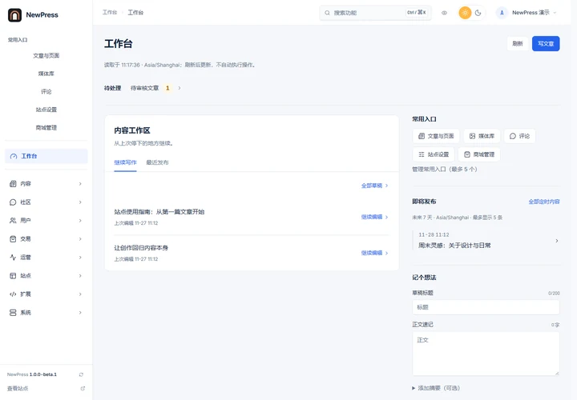
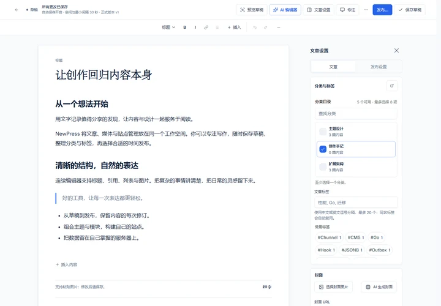
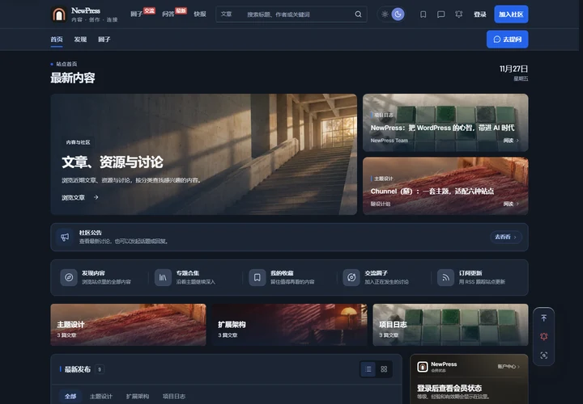
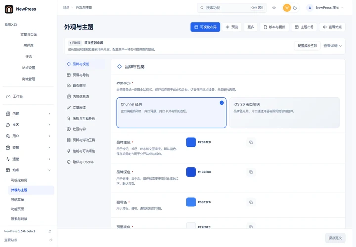
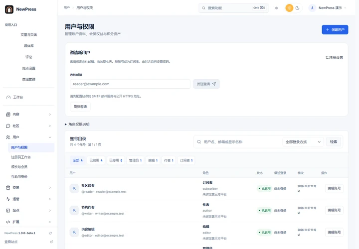
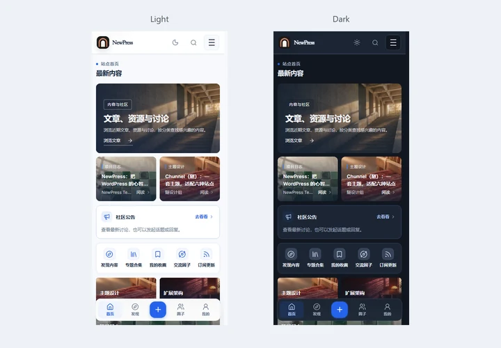

<p align="center">
  
</p>

<h1 align="center">NewPress</h1>

<p align="center">
  <a href="README.md">简体中文</a> &nbsp;·&nbsp;
  <a href="README.zh-TW.md">繁體中文</a> &nbsp;·&nbsp;
  <a href="README.en.md">English</a> &nbsp;·&nbsp;
  <a href="README.ja.md">日本語</a>
</p>

<p align="center">使用 Go 建置的自架內容管理系統</p>

<p align="center">
  <a href="internal/version/version.go"></a>
  <a href="go.mod"></a>
  <a href="#部署"></a>
  <a href="LICENSE"></a>
</p>

<p align="center">
  <a href="#介面預覽">介面預覽</a> &nbsp;·&nbsp;
  <a href="#部署">部署</a> &nbsp;·&nbsp;
  <a href="#首次登入">首次登入</a> &nbsp;·&nbsp;
  <a href="#設定">設定</a> &nbsp;·&nbsp;
  <a href="#更新與維護">更新與維護</a> &nbsp;·&nbsp;
  <a href="#備份與還原">備份與還原</a> &nbsp;·&nbsp;
  <a href="#常見問題">常見問題</a>
</p>

---

NewPress 提供文章、頁面、媒體庫與管理後台，可用於部落格、資源分享、社群及企業網站。標準 Docker 映像與原生安裝精靈在新安裝時僅預裝並預設使用 Chunnel 佈景主題，其他佈景主題按需安裝；原始碼目錄還包含開發範例佈景主題。內容可儲存在本機檔案或 PostgreSQL 中。

> [!NOTE]
> 目前原始碼版本為 `1.0.0-beta.1`，尚未發布穩定版。檔案儲存僅支援單一程序寫入；登入工作階段已持久化，有效期限內重新啟動可繼續使用。詳見[工作階段與部署限制](SESSION_PERSISTENCE.md)。

| 功能 | 內容 |
| --- | --- |
| 內容管理 | 文章與頁面、分類與標籤、修訂、自動儲存、留言審核 |
| 媒體與外觀 | 媒體庫、導覽設定、首頁版面配置、佈景主題安裝與切換 |
| 帳號與權限 | 使用者管理、角色與權限、註冊設定 |
| 內容移轉 | Markdown 檔案、WordPress WXR 1.2 匯入與預覽 |
| 擴充管理 | 官方佈景主題與外掛目錄、簽章驗證、安裝、更新與回復舊版 |
| 選用模組 | 圈子、私人訊息、通知、商城、積分與虛擬幣、AI 輔助編輯；使用前請設定對應模組與服務 |

維護者：**ChunYang** · 公開聯絡方式：[Chunnel@linux.do](mailto:Chunnel@linux.do)

主程式：[GitHub 主儲存庫](https://github.com/chunyangnet/NewPress) · [Gitee 中國大陸鏡像](https://gitee.com/chunyangnet_0/newpress)。兩邊發布相同的原始碼提交與版本標籤。佈景主題與外掛繼續使用各自獨立的 Orangefen GitHub 儲存庫，以及統一 Gitee 帳號下的鏡像，不隨主程式帳號移轉。

## 介面預覽

點選縮圖即可查看原尺寸截圖。截圖來自 `1.0.0-beta.1` 的隔離示範環境，使用示範資料與簡體中文介面；實際外觀會隨佈景主題設定及啟用模組而變化。

| 首頁 | 後台工作台 |
| --- | --- |
| [](assets/screenshots/home-desktop.webp) | [](assets/screenshots/admin-dashboard.webp) |

| 文章閱讀 | 內容編輯器 |
| --- | --- |
| [](assets/screenshots/article-desktop.webp) | [](assets/screenshots/admin-editor.webp) |

<details>
<summary>更多截圖：深色模式、外觀設定、使用者管理與手機版</summary>

| 深色首頁 | 外觀設定 |
| --- | --- |
| [](assets/screenshots/home-dark.webp) | [](assets/screenshots/admin-appearance.webp) |

| 使用者管理 | 手機版：淺色與深色 |
| --- | --- |
| [](assets/screenshots/admin-users.webp) | [](assets/screenshots/mobile.webp) |

</details>

## 部署

### 雙來源原始碼安裝入口

以下指令供儲存庫公開，且兩邊均已發布 `v1.0.0-beta.1` 標籤後使用。首次公開前，請將專案上傳至伺服器，使用下一節的本機原始碼安裝精靈；儲存庫或標籤尚無法存取時，安裝程式會明確報錯。

伺服器需要 Linux、Bash、Git 與 curl。Debian / Ubuntu 可先執行 `sudo apt-get update && sudo apt-get install -y git curl ca-certificates`。請以一般使用者下載並執行入口腳本，精靈會在安裝系統服務時視需要使用 sudo。

**GitHub 入口：**

```bash
curl --proto '=https' --proto-redir '=https' -fL --connect-timeout 10 --max-time 60 -o newpress-install.sh https://raw.githubusercontent.com/chunyangnet/NewPress/v1.0.0-beta.1/install.sh && \
bash newpress-install.sh --source github --dir ./newpress
```

**Gitee 入口（取得安裝程式與主程式原始碼均不依賴 GitHub）：**

```bash
curl --proto '=https' --proto-redir '=https' -fL --connect-timeout 10 --max-time 60 -o newpress-install.sh https://gitee.com/chunyangnet_0/newpress/raw/v1.0.0-beta.1/install.sh && \
bash newpress-install.sh --source gitee --dir ./newpress
```

已取得安裝程式時，可用 `--source auto` 依 GitHub、Gitee 的順序在失敗時切換；`--ref` 指定其他已發布標籤，`--commit` 可額外核對發行說明中的完整提交 SHA。自動切換不會猜測伺服器所在地。`--source` 控制主程式儲存庫，後續 Go / Docker 相依套件仍由部署精靈獨立偵測、驗證與選擇來源。

安裝程式只寫入**尚不存在的新目錄**，不會覆寫既有原始碼、設定或網站資料。部署參數放在 `--` 後，例如 `bash newpress-install.sh --source gitee --dir ./newpress -- --mode native`。安裝後請保留該原始碼目錄，後續管理指令均透過其中的 `scripts/deploy.sh` 執行。

### Linux 安裝精靈

支援 Linux `amd64` / `arm64`。取得完整原始碼後，在包含 `go.mod`、`compose.yaml`、`themes/` 與 `plugins/` 的專案根目錄執行：

```bash
sudo bash scripts/deploy.sh
```

在選單中選擇「安装 / 更新」（安裝 / 更新），依提示選擇部署方式，填寫監聽位址、連接埠與網站存取網址。首次安裝會設定管理員，完成後顯示存取網址與健康檢查結果。

| 方式 | 執行元件 | 環境 |
| --- | --- | --- |
| Docker Compose | NewPress、PostgreSQL、NGINX | 本機 Docker Engine、Compose 2.20+、Buildx |
| 原生服務 | NewPress 執行檔、systemd；預設使用檔案儲存 | 正在執行的 systemd；腳本視需要取得 Go 工具鏈並建置 |

精靈使用 Bash 與 Python 3.9+，Bash 入口可引導安裝缺少的 Python。Docker 自動安裝支援 Debian / Ubuntu；其他發行版須先準備 Docker 環境。部署使用儲存庫內已產生的前端資源，無須安裝 Node.js。

網域與 HTTPS 請依[設定](#設定)一節處理。首次執行無須先複製 `.env.example`，精靈會產生環境檔案。

<details>
<summary>手動 Docker Compose：PowerShell 7.2+ 範例</summary>

適用於首次初始化空白環境，使用 Docker 的 Linux 容器模式。範例依預設映像名稱 `newpress:local` 建置，透過容器產生管理員密碼雜湊，主機無須安裝 Go。

```powershell
Copy-Item .env.example .env
New-Item -ItemType Directory -Force .secrets | Out-Null

docker compose build migrate
if ($LASTEXITCODE -ne 0) { throw '映像建置失敗' }

$databasePassword = [Convert]::ToHexString([Security.Cryptography.RandomNumberGenerator]::GetBytes(32)).ToLowerInvariant()
Set-Content -LiteralPath .secrets/postgres_password -Value $databasePassword -Encoding utf8 -NoNewline
Set-Content -LiteralPath .secrets/database_url -Value "postgres://newpress:$databasePassword@db:5432/newpress?sslmode=disable" -Encoding utf8 -NoNewline
Read-Host '管理員密碼（至少 12 個字元）' -MaskInput |
    docker run --rm -i --network none newpress:local admin hash-password |
    Set-Content -LiteralPath .secrets/admin_password_hash -Encoding utf8 -NoNewline
if ($LASTEXITCODE -ne 0) { throw '管理員密碼雜湊產生失敗' }
Remove-Variable databasePassword

docker compose config --quiet
if ($LASTEXITCODE -ne 0) { throw 'Compose 設定檢查失敗' }
docker compose up -d --no-build --wait
```

預設網址為 <http://localhost:8080>，後台為 <http://localhost:8080/admin/>。Compose 僅向主機公開 NGINX 的 HTTP 連接埠，應用程式與資料庫使用內部網路。部署至伺服器時，請將 `NEWPRESS_PUBLIC_URL` 改為實際存取網址，並設定 HTTPS。

保留產生的 `.env` 與 `.secrets/`；既有網站的更新請依[更新與維護](#更新與維護)執行。金鑰檔案應僅對維運帳號與需要讀取的服務開放，執行資料與憑證資訊不應提交至儲存庫。

</details>

<details>
<summary>從本機原始碼執行：Go 與 PowerShell 7.2+ 範例</summary>

需要 Go 1.26.11，工具鏈宣告見 [go.mod](go.mod)。儲存庫已包含產生的前端資源。

僅檢視網站與後台唯讀預覽：

```sh
go run ./cmd/newpress serve
```

開啟 <http://localhost:8080>。若要建立管理員並使用可寫入的後台，請先停止預覽程序，再執行：

```powershell
New-Item -ItemType Directory -Force .secrets | Out-Null
Read-Host '管理員密碼（至少 12 個字元）' -MaskInput |
    go run ./cmd/newpress admin hash-password |
    Set-Content -LiteralPath .secrets/admin_password_hash -Encoding utf8 -NoNewline
if ($LASTEXITCODE -ne 0) { throw '管理員密碼雜湊產生失敗' }

$env:NEWPRESS_ADMIN_USERNAME = 'admin'
$env:NEWPRESS_ADMIN_PASSWORD_HASH_FILE = (Resolve-Path .secrets/admin_password_hash).Path
go run ./cmd/newpress serve
```

管理員僅在空白使用者資料庫中建立，後續引導設定不會覆寫既有帳號。直接執行時，請透過程序環境變數傳入設定；程式不會自動讀取專案的 `.env`。

預設初始化空白網站。檔案儲存模式下，若要查看示範文章，需在首次建立內容庫前設定 `NEWPRESS_SEED_DEMO=true`；既有內容庫（包括已初始化的空庫）不會補入示範文章。可將 `NEWPRESS_DATA_DIR` 指向新的獨立目錄後啟動示範網站。標準 Compose 的應用程式服務固定關閉示範內容。

</details>

## 首次登入

使用安裝結束時顯示的網站網址，後台入口為同一網站的 `/admin/`。

沒有預設的管理員密碼。Linux 精靈支援自訂登入名稱與密碼，密碼至少 12 個字元，輸入內容會隱藏。自訂密碼僅儲存雜湊；留空時產生隨機密碼，並儲存至權限受限的首次登入檔案：

| 部署方式 | 首次登入檔案的預設位置 |
| --- | --- |
| Docker 精靈 | `.secrets/first-login.txt` |
| 原生精靈 | `/etc/newpress/first-login.txt` |

自訂密碼時不會產生該明文檔案。既有管理員的資料與密碼可在後台修改。

| 後台入口 | 常用設定 |
| --- | --- |
| `/admin/settings/` | 網站名稱、語言、時區、註冊方式、模組與服務設定 |
| `/admin/appearance/` | 目前佈景主題設定與首頁版面配置 |
| `/admin/navigation/` | 導覽選單與連結 |
| `/admin/users/` | 管理員資料、使用者與權限 |
| `/admin/import/` | 匯入 Markdown 或 WordPress WXR 內容，先預覽再確認 |

透過 Linux 精靈部署的網站，可在帳號選單查詢登入名稱或重設密碼。重設後，該帳號原有的登入工作階段會失效。

```bash
sudo bash scripts/deploy.sh admin
```

## 設定

設定項目見 [.env.example](.env.example)。部署環境控制監聽、資料庫連線與受信任的代理伺服器；網站名稱、外觀與日常營運設定由後台管理。

| 執行方式 | 設定來源 |
| --- | --- |
| Docker Compose | 專案根目錄的 `.env` 與 `.secrets/` |
| 原生 systemd | `/etc/newpress/newpress.env` 與 `/etc/newpress/secrets/` |
| 本機原始碼 | 啟動程序的環境變數，憑證資訊可透過對應的 `*_FILE` 變數讀取 |

首次安裝前，可在專案根目錄準備 `.env` 供精靈讀取。網站設定於首次啟動時初始化；之後由後台儲存的值優先，重新部署不會覆寫既有設定。

<details>
<summary>常用環境變數與預設值</summary>

| 設定項目 | 預設值 | 用途 |
| --- | --- | --- |
| `NEWPRESS_PUBLIC_URL` | `http://localhost:8080` | 使用者實際存取的網站 origin，影響連結、同源驗證與 Cookie |
| `NEWPRESS_HTTP_BIND` | `0.0.0.0` | Compose / 精靈的主機監聽位址 |
| `NEWPRESS_HTTP_PORT` | `8080` | Compose / 精靈的 HTTP 連接埠 |
| `NEWPRESS_ADDR` | `:8080` | 直接執行 Go 服務時的監聽位址 |
| `NEWPRESS_DATABASE_URL` / `NEWPRESS_DATABASE_URL_FILE` | 未設定 | 直接執行時，未設定則使用檔案儲存；標準 Compose 已掛載 PostgreSQL 連線機密檔案 |
| `NEWPRESS_COMMUNITY_ENABLED` | `false` | 啟用伺服器端圈子服務，另須在後台啟用社群模組 |

</details>

### 網域與 HTTPS

憑證與外部 NGINX / Caddy 由部署者設定。將 `NEWPRESS_PUBLIC_URL` 填為實際存取網址，例如 `https://example.com`；僅填寫 HTTPS 網址不會完成憑證設定。

使用 Linux 精靈與本機外部反向代理時，在使用中的環境檔案設定：

```dotenv
NEWPRESS_PUBLIC_URL=https://example.com
NEWPRESS_HTTP_BIND=127.0.0.1
NEWPRESS_HTTP_PORT=8080
NEWPRESS_PROXY_MODE=local
```

外部代理指向 `http://127.0.0.1:8080`，保留 `Host`，並依實際連線重建 `X-Forwarded-For` 與 `X-Forwarded-Proto`。遠端代理使用 `NEWPRESS_PROXY_MODE=remote`，並在 `NEWPRESS_EXTERNAL_PROXY_CIDRS` 填寫精確的來源網段。

既有原生服務若明確設定了 `NEWPRESS_TRUSTED_PROXY_CIDRS`，切換代理時也須同步修改；本機 IPv4 代理為 `127.0.0.1/32`。

`NEWPRESS_PROXY_MODE` 由部署腳本處理。手動 Compose 使用的 [NGINX 範本](deploy/nginx.conf)預設面向 HTTP 直接連線；外部 HTTPS 反向代理須自行調整代理標頭處理，可用 `NEWPRESS_NGINX_CONFIG` 指定獨立設定。直接執行服務時，使用 `NEWPRESS_TRUSTED_PROXY_CIDRS` 設定實際受信任的代理伺服器。

修改環境檔案後，請依下一節套用設定；網域解析、外部代理與防火牆規則也須配合監聽位址。

## 更新與維護

更新前先完成備份，閱讀 [CHANGELOG.md](CHANGELOG.md)，再將本機原始碼更新至目標版本。

透過 Linux 精靈部署的網站，請在原專案目錄執行：

| 操作 | 指令 |
| --- | --- |
| 檢查環境與下載來源 | `sudo bash scripts/deploy.sh check` |
| 套用原始碼或設定變更 | `sudo bash scripts/deploy.sh deploy` |
| 檢視執行狀態 | `sudo bash scripts/deploy.sh status` |
| 持續追蹤最近的日誌 | `sudo bash scripts/deploy.sh logs --tail 100 --follow` |
| 重新啟動網站 | `sudo bash scripts/deploy.sh restart` |
| 停止網站 | `sudo bash scripts/deploy.sh stop` |

Docker 模式的重新啟動與停止僅操作 `app` 和 `proxy`，資料庫會持續執行。`restart` 不會重新建立容器，修改 `.env` 或 Compose 檔案後請使用 `deploy`。

手動 Compose 的原始碼或設定更新：

```sh
docker compose build migrate
docker compose up -d --no-build --wait
```

部署腳本會保留已儲存的基底映像參照。需要升級這些映像時，請核對並修改環境檔案中的 `NEWPRESS_GO_IMAGE`、`NEWPRESS_RUNTIME_IMAGE`、`NEWPRESS_POSTGRES_IMAGE` 與 `NEWPRESS_PROXY_IMAGE`；參照須包含完整的 SHA-256 digest。

附加 Compose 檔案可透過重複的 `--compose-file` 依序選擇。明確傳入參數會取代已儲存的清單，需同時列出所有要保留的附加檔案；省略該參數時才重用既有清單。基礎 `compose.yaml` 會自動加入，僅指定它可清除附加檔案選擇。例如啟用郵件設定：

```bash
sudo bash scripts/deploy.sh deploy --compose-file deploy/compose.mail.yaml
```

使用[郵件設定](deploy/compose.mail.yaml)等附加檔案前，請先準備檔案要求的服務參數與機密檔案（secret）。

### 後台核心更新

線上安裝需要透過 `newpress run` 啟動託管模式，標準 Docker Compose 與原生安裝精靈已採用此方式。本機原始碼範例中的 `serve` 不支援線上切換；需要此功能時，請先建置二進位檔，再用 `newpress run` 啟動。

後台 `/admin/updates/` 預設使用官方公開雙來源，無須 GitHub / Gitee 存取權杖：

- GitHub：`chunyangnet/NewPress` 的 `releases` 分支；
- Gitee：`chunyangnet_0/newpress` 的 `releases` 分支；
- 目前測試版通道：`updates/beta.json`。

官方更新公鑰隨程式內建，首次安裝無須填寫公鑰或存取權杖，公開公鑰檔案見 [official_ed25519.pub](internal/update/official_ed25519.pub)。需要自訂發布者時，可透過受信任的管道取得其公鑰，並設定 `NEWPRESS_UPDATE_PUBLIC_KEY` 覆寫內建值；私有來源必須明確設定發布者的公鑰。無效的覆寫值會報錯，不會靜默退回官方公鑰。程式不會從待驗證的更新儲存庫自動匯入新公鑰。發布分支或簽章清單尚未上傳時，檢查會明確失敗，不會將缺少檔案視為「已是最新版本」。

伺服器會平行驗證兩邊清單，優先採用有效且簽章序號較高的清單；相同序號的內容衝突時會停止更新。更新套件僅在已驗證為相同發布版本的來源間切換，各來源固定至檢查時的提交，並再次核對套件長度與 SHA-256。既有 Gitee 私有來源設定會保留，可在更新來源設定中切回官方公開雙來源；公開請求不會攜帶私有權杖。

安裝前請閱讀發行說明，並確認備份可還原。原始碼更新仍須依前述步驟重新部署；初始託管程式、容器基底映像或部署協定升級，也透過原始碼 / 映像重新部署完成。請勿使用首次安裝程式覆寫既有目錄。

<details>
<summary>PostgreSQL 線上升級：還原驗證回執設定</summary>

使用 PostgreSQL 的網站（包括預設 Docker Compose 部署），線上安裝前還須提供與本次升級相符，且備份與還原演練均於 24 小時內完成的 JSON 回執。回執由維運人員依實際結果填寫，不會自動執行或取代資料庫還原。

回執欄位：`schema` 為 `1`；`site` 與網站 `NEWPRESS_PUBLIC_URL` 完全一致；`from`、`to` 分別為目前與目標核心版本；`captured_at`、`restore_verified_at` 為含時區的實際備份與還原驗證時間，驗證時間不得早於備份或晚於目前時間；`database_snapshot`、`site_files_snapshot` 為可追溯的資料庫與網站檔案備份識別碼。請勿在回執中填入資料庫憑證資訊。

Docker 將回執儲存在 `.secrets/update-recovery/backup.json`（自訂 `NEWPRESS_SECRETS_DIR` 時使用對應目錄），確保容器服務使用者可讀取、只有維運人員可寫入，再啟用唯讀掛載：

```bash
sudo bash scripts/deploy.sh deploy --compose-file deploy/compose.update-recovery.yaml
```

若已啟用郵件等附加設定，以上命令還需重複傳入對應的 `--compose-file`，以保留完整清單。此設定無須 Gitee 權杖。舊有 `deploy/compose.updates-secret.yaml` 仍供私有來源使用。原生 PostgreSQL 部署則在服務環境中，將 `NEWPRESS_UPDATE_BACKUP_RECEIPT_FILE` 指向受限回執檔案的絕對路徑。每次升級均須重新備份、驗證並更新回執；不符合條件時，請改用停機備份與原始碼重新部署流程。

</details>

## 備份與還原

備份應同時保存網站內容、媒體與部署設定。以下位置依預設部署路徑列出：

| 執行方式 | 需要保存的內容 |
| --- | --- |
| 本機檔案儲存 | 資料、媒體、佈景主題與外掛目錄，以及部署環境與憑證資訊 |
| 標準 Docker Compose | PostgreSQL 備份、資料、佈景主題、外掛與更新持久磁碟區，以及 `.env`、`.secrets/` |
| 原生 systemd | `/var/lib/newpress/` 與 `/etc/newpress/`；連線至 PostgreSQL 時另行備份資料庫 |

自訂目錄以 `NEWPRESS_DATA_DIR`、`NEWPRESS_THEMES_DIR`、`NEWPRESS_PLUGINS_DIR` 的實際值為準。Docker 持久磁碟區定義見 [compose.yaml](compose.yaml)。

### 檔案儲存

內建備份指令僅支援檔案儲存。請先停止使用相同資料、佈景主題與外掛目錄的服務，再於原設定環境中執行。以下為本機原始碼執行範例：

```sh
go run ./cmd/newpress backup create ./site-backup.zip
go run ./cmd/newpress backup inspect ./site-backup.zip
go run ./cmd/newpress backup restore ./site-backup.zip --destination ./restored-site
```

封存檔包含上述三個目錄中的資料、媒體、佈景主題與外掛；部署環境、目錄外的憑證資訊與應用程式執行檔須另行保存。封存檔必須放在這三個來源目錄之外，還原目標必須是新目錄或空目錄。

還原指令會檢查封存檔並輸出還原後的環境設定。依輸出中的 `environment` 設定資料、佈景主題與外掛路徑後再啟動服務；原網站不會被覆寫。

### PostgreSQL

使用 `pg_dump` / `pg_restore` 等 PostgreSQL 工具備份與還原資料庫，並保存相同備份時間點的媒體、佈景主題、外掛及部署設定。檔案模式的 `backup create` 不能取代資料庫備份。

將備份保存在網站執行目錄之外，並於獨立目錄或獨立資料庫驗證還原。

## 常見問題

<details>
<summary>伺服器下載相依套件或映像較慢，該怎麼辦？</summary>

Linux 精靈預設使用 `auto` 策略，偵測官方來源與內建的中國大陸來源，依目前伺服器的取樣結果選擇來源，下載失敗後嘗試其他可用來源。手動 Compose 可參考 [.env.example](.env.example) 設定 `NEWPRESS_GOPROXY`；Go 校驗資料庫會保持啟用。

</details>

<details>
<summary>能直接使用 WordPress 的佈景主題與外掛嗎？</summary>

不能。NewPress 支援文章、頁面、分類等類似內容模型，可移入 Markdown 與 WordPress WXR 1.2 內容；PHP 佈景主題、PHP 外掛及 WordPress 執行期介面並不相容。

</details>

<details>
<summary>為什麼本機後台只能檢視，無法儲存？</summary>

使用者資料庫為空，且未設定管理員引導雜湊時，後台僅允許回環位址唯讀預覽。請依[部署](#部署)中從本機原始碼執行的管理員範例建立帳號後登入；既有帳號的資料與密碼由後台修改。

</details>

<details>
<summary>能執行多個執行個體嗎？</summary>

檔案模式僅支援單一程序寫入，程序內可處理並行請求。登入工作階段隨儲存模式寫入私有檔案或 PostgreSQL，有效期限內重新啟動可繼續使用；PostgreSQL 工作階段支援共用讀取與撤銷。完整應用仍以單一執行個體部署為支援範圍，本機目錄鎖定與媒體、文章互動等狀態的限制仍保留。詳見[工作階段與部署限制](SESSION_PERSISTENCE.md)。

</details>

<details>
<summary>有哪些介面語言？</summary>

核心共用字串與 Starter 佈景主題提供簡體中文、繁體中文、英文、日文。Chunnel、後台與部分業務介面仍有固定中文文案，切換網站語言不會自動翻譯文章或未接入語言套件的介面。支援範圍見[語言套件說明](internal/i18n/README.md)。

</details>

<details>
<summary>使用 AI 輔助編輯需要什麼？</summary>

請在後台設定對應模組、模型服務位址、憑證資訊與模型。文字及圖片功能取決於接入服務支援的介面；使用付費服務時，呼叫費用依服務供應商的規則計算。

</details>

## 貢獻與授權條款

回報問題時，請附上版本、部署方式、實際行為與已移除敏感資訊的日誌。安全問題請依 [SECURITY.md](SECURITY.md) 私下回報。

<details>
<summary>原始碼開發與檢查</summary>

修改前端需要 Node.js 22+。請執行以下檢查，完整貢獻流程見 [CONTRIBUTING.md](CONTRIBUTING.md)：

```sh
npm ci --ignore-scripts
npm run build:frontend
npm run typecheck:frontend
npm run check:frontend
npm run test:frontend
go test ./...
go vet ./...
go build -trimpath -buildvcs=false ./cmd/newpress
```

開發規範見[公開指南](themes/README.md)，範例可從 [Starter](themes/starter/README.md)、[子佈景主題範例](themes/starter-child/README.md)與[呈現契約](internal/presentation/page.go)開始。設計慣例見 [DESIGN.md](DESIGN.md)，發布準備見 [RELEASING.md](RELEASING.md)。

公開說明隨原始碼提供。`docs/` 是維護者的本機資料，不包含在公開原始碼封存檔或 Docker 建置上下文（build context）中。

</details>

原創程式碼採用 [Apache-2.0](LICENSE)。第三方相依套件、字型與圖片保留各自授權條款，詳見 [THIRD_PARTY_NOTICES.md](THIRD_PARTY_NOTICES.md) 及資源目錄聲明。內建授權清單可透過 `go run ./cmd/newpress licenses` 檢視。

## 社群支援

歡迎在 Linux.do 社群交流使用問題、分享經驗；也可以透過 [Chunnel@linux.do](mailto:Chunnel@linux.do) 聯絡維護者。

<p align="center">
  <a href="https://linux.do/"></a>
</p>
